# Software Design Document (SDD)
## Project: SnapSync — Cloud-Native Multi-Tenant Photobooth SaaS & Smart Kiosk Platform

**Document Version:** 1.0.0  
**Status:** Approved for Baseline (Engineering Release)  
**Course / Track:** Software Engineering Practice Assignment (PA3 — Architectural, Object-Oriented & Data Design)  
**Target Platform:** Multi-Tenant Cloud Backend (FastAPI / PostgreSQL), Smart Kiosk Terminal (Electron / Touchscreen), and Mobile Asset Viewer  

---

## Table of Contents
- [2. Design Overview](#2-design-overview)
  - [2.1 Design Goals and Constraints](#21-design-goals-and-constraints)
- [3. Architectural Design](#3-architectural-design)
  - [3.1 Architectural Style](#31-architectural-style)
  - [3.2 System Context Diagram (C4 level 1)](#32-system-context-diagram-c4-level-1)
  - [3.3 Container Diagram (C4 level 2)](#33-container-diagram-c4-level-2)
  - [3.4 Component Diagram](#34-component-diagram)
  - [3.5 Deployment Diagram](#35-deployment-diagram)
  - [3.6 Architecture Decision Records](#36-architecture-decision-records)
- [4. Object-Oriented Design](#4-object-oriented-design)
  - [4.1 Domain Model](#41-domain-model)
  - [4.2 Class Diagram](#42-class-diagram)
  - [4.3 Class Specifications](#43-class-specifications)
    - [4.3.1 Class C1: Tenant](#431-class-c1-tenant)
    - [4.3.2 Class C2: User](#432-class-c2-user)
    - [4.3.3 Class C3: Machine](#433-class-c3-machine)
    - [4.3.4 Class C4: Package](#434-class-c4-package)
    - [4.3.5 Class C5: Order](#435-class-c5-order)
    - [4.3.6 Class C6: Payment](#436-class-c6-payment)
    - [4.3.7 Class C7: PaymentEvent](#437-class-c7-paymentevent)
    - [4.3.8 Class C8: OrderStateMachine](#438-class-c8-orderstatemachine)
  - [4.4 Sequence Diagrams](#44-sequence-diagrams)
    - [4.4.1 SD-01: User Authentication & JWT Issuance (UC-01)](#441-sd-01-user-authentication--jwt-issuance-uc-01)
    - [4.4.2 SD-02: Create Photobooth Order & Generate VietQR (UC-03)](#442-sd-02-create-photobooth-order--generate-vietqr-uc-03)
    - [4.4.3 SD-03: Process Payment Webhook Idempotently with Concurrency Guards (UC-04)](#443-sd-03-process-payment-webhook-idempotently-with-concurrency-guards-uc-04)
    - [4.4.4 SD-04: Poll Payment Status & Unlock Kiosk Session (UC-05)](#444-sd-04-poll-payment-status--unlock-kiosk-session-uc-05)
    - [4.4.5 SD-05: Deliver Digital Assets via Pre-Signed URL (UC-07)](#445-sd-05-deliver-digital-assets-via-pre-signed-url-uc-07)
  - [4.5 State Machine Diagrams](#45-state-machine-diagrams)
    - [4.5.1 Order Lifecycle State Machine](#451-order-lifecycle-state-machine)
    - [4.5.2 Machine Operational State Machine](#452-machine-operational-state-machine)
  - [4.6 Design Principles and Patterns](#46-design-principles-and-patterns)
- [5. Data Design](#5-data-design)
  - [5.1 Data Diagram (Entity-Relationship Diagram)](#51-data-diagram-entity-relationship-diagram)
  - [5.2 Data Specification](#52-data-specification)
  - [5.3 Normalisation and Indexes](#53-normalisation-and-indexes)

---

# 2. Design Overview

## 2.1 Design Goals and Constraints

The primary mission of the **SnapSync** architecture is to deliver a cloud-native, multi-tenant SaaS backend and unattended edge kiosk platform capable of orchestrating instantaneous cashless point-of-sale transactions, reliable hardware session unlocking, and privacy-preserving digital media delivery across hundreds of franchise photobooths.

### 2.1.1 Architecturally Significant Requirements (ASRs)

The design is driven directly by the key Non-Functional Requirements (NFRs) and high-priority Functional Requirements (FRs) defined in the System Requirements Specification (SRS):

1. **High Concurrency & Idempotent Payment Processing (NFR-02, FR-08, FR-09):**
   - The Napas 24/7 bank clearing network and PayOS payment gateway deliver transaction webhooks under an "at-least-once" guarantee. Due to edge network retries or simultaneous transfer posts, duplicate webhooks frequently arrive within milliseconds of each other.
   - **Architectural Goal:** The backend must guarantee mathematical idempotency (100% deduplication) under concurrent webhook bursts (`asyncio.gather()`). Exactly one state transition (`PENDING -> PAID`) must occur; exactly one payment event must be recorded; zero double-fulfillment or double-charging errors may occur.

2. **Ultra-Low Latency & High-Throughput I/O (NFR-01, NFR-06):**
   - Kiosk touchscreen terminals continuously poll order payment status every 2 seconds during customer checkout.
   - **Architectural Goal:** API endpoints must maintain a P95 response latency ≤ 80 ms under a baseline load of 200 concurrent HTTP clients. Dynamic VietQR codes must be generated and returned to kiosk screens within ≤ 1.5 seconds of package selection.

3. **Strict Multi-Tenant Isolation & Role-Based Security (NFR-03, FR-01, FR-02):**
   - Multiple independent franchise operators share the cloud infrastructure. Franchisees must never view, mutate, or access another tenant’s sales records, revenue, or kiosk hardware telemetry.
   - **Architectural Goal:** Every database query must be programmatically or logically scoped by `tenant_id`. Stateless HMAC-SHA256 signed JSON Web Tokens (JWT) must enforce strict Role-Based Access Control (`admin`, `operator`, `customer`) without maintaining server-side session state.

4. **Data Integrity & Double-Entry Financial Auditability (NFR-05, FR-10, FR-11):**
   - Photobooths operate unattended; physical cash cannot be reconciled manually.
   - **Architectural Goal:** All financial transactions, status mutations, and raw webhook payloads must be immutably recorded in a dual-table ledger (`payments` and `payment_events`) using ACID transactions with PostgreSQL pessimistic locking (`SELECT ... FOR UPDATE`) to prevent dirty reads and lost updates.

5. **Customer Privacy & Ephemeral Storage Offloading (BR-05, FR-14, FR-15):**
   - Under Vietnam Decree 13/2023/ND-CP on Personal Data Protection (PDPD), personal biometric photos and video timelapses must not be retained indefinitely or exposed through insecure public endpoints.
   - **Architectural Goal:** High-resolution photo prints (1200x1800 dpi, ~10 MB) and MP4 video clips (~25 MB) must be uploaded directly from the kiosk to cloud object storage (S3/MinIO) via Pre-Signed URLs, bypassing API server bandwidth entirely. Storage objects must automatically expire and permanently purge after 72 hours.

### 2.1.2 Design Constraints

1. **Technology Constraints:**
   - **Runtime:** Python 3.12 managed via `uv` package resolver for reproducible, deterministic builds.
   - **Web Framework:** FastAPI with Starlette ASGI server (Uvicorn) to execute high-throughput asynchronous non-blocking event loops.
   - **Persistence:** PostgreSQL 16 utilizing asynchronous connections via `asyncpg` and SQLAlchemy 2.0 Declarative ORM.
   - **Payment Protocols:** Standardized State Bank of Vietnam Napas 24/7 EMVCo QR specification (VietQR) and PayOS HMAC-SHA256 webhook signing.
   - **Storage Protocol:** S3-compliant object storage API (AWS S3, Cloudflare R2, or local MinIO container for development).

2. **Operational & Budget Constraints:**
   - **Compute Footprint:** The entire backend service, database, and cache must execute reliably within a budget-friendly single virtual private server (2 vCPU, 4 GB RAM) during early-stage franchise rollout, scaling horizontally via containerization as machine count expands.
   - **Edge Hardware Heterogeneity:** Touchscreen kiosks are deployed across varied commercial environments with varying edge hardware (Intel NUCs, mini-PCs running Windows IoT or Ubuntu Linux) and cellular 4G LTE connections subject to intermittent packet loss.

3. **Deadline & Delivery Constraints:**
   - Incremental 4-phase agile engineering timeline requiring Day 1 foundational REST APIs, Day 2 VietQR & webhook idempotency engines, Day 3 kiosk hardware integration, and Day 4 telemetry & security hardening.

---

# 3. Architectural Design

## 3.1 Architectural Style

SnapSync employs a **Hybrid Architectural Style** combining:
1. **Layered / Clean Architecture** within the core backend service container.
2. **Distributed Client-Server Architecture** between unattended kiosk edge nodes, web management portals, and cloud services.
3. **Event-Driven & Asynchronous Webhook Architecture** for real-time payment reconciliation and state notification.

```
+-------------------------------------------------------------------------+
|                        Presentation Layer (API)                         |
|        FastAPI Routers (Auth, Machines, Orders, Payments, Webhooks)     |
+-------------------------------------------------------------------------+
                                    |
                                    v
+-------------------------------------------------------------------------+
|                    Application / Orchestration Layer                    |
|       Order Service, Payment Orchestrator, Machine Fleet Manager        |
+-------------------------------------------------------------------------+
                                    |
                                    v
+-------------------------------------------------------------------------+
|                          Domain Logic Layer                             |
|       Finite State Machine (OrderStateMachine), VietQR Generator,       |
|            HMAC Verification & Cryptographic Security Rules             |
+-------------------------------------------------------------------------+
                                    |
                                    v
+-------------------------------------------------------------------------+
|                     Data Access & Infrastructure Layer                  |
|    SQLAlchemy 2.0 Async Repositories, PostgreSQL 16, asyncpg Pool,      |
|               S3 Object Storage Adapter, Redis Cache                    |
+-------------------------------------------------------------------------+
```

### 3.1.1 Justification Against Design Goals

| Architectural Style | Applied Subsystem | Justification against Design Goals |
| :--- | :--- | :--- |
| **Layered / Clean Architecture** | FastAPI SaaS Backend | Enforces strict separation of concerns. Routers parse HTTP payloads; Application Services orchestrate use cases; Domain Entities and State Machines enforce business invariants; Repositories handle database operations. This guarantees testability (100% unit-testable domain logic without DB dependencies) and prevents business logic leakage into presentation endpoints. |
| **Distributed Client-Server** | Edge Kiosks ↔ Cloud Backend ↔ Mobile Web | Decouples heavy edge photobooth hardware control (Canon DSLR capture, DNP dye-sub photo printing) from centralized franchise billing, multi-tenant authentication, and inventory telemetry. Kiosks operate as autonomous clients communicating strictly via TLS 1.3 encrypted REST and WebSockets. |
| **Event-Driven Webhook Processing** | PayOS Gateway ↔ Backend ↔ Kiosk Session | Financial transactions originate asynchronously within commercial banking apps (Napas 24/7). An event-driven webhook architecture eliminates costly continuous outbound bank polling, responding instantaneously to HMAC-verified gateway events while decoupling order settlement from edge hardware readiness. |
| **Asynchronous Non-Blocking I/O** | Python `asyncio` + `asyncpg` | Addresses high-frequency kiosk status polling (NFR-01). Asynchronous coroutines release OS worker threads during database network round-trips, allowing a single worker process to sustain thousands of concurrent connections with minimal memory overhead. |

---

## 3.2 System Context Diagram (C4 level 1)

The System Context diagram illustrates the boundary of the **SnapSync Photobooth SaaS Platform**, the human actors who interact with it, and the external software and banking systems with which it interfaces.

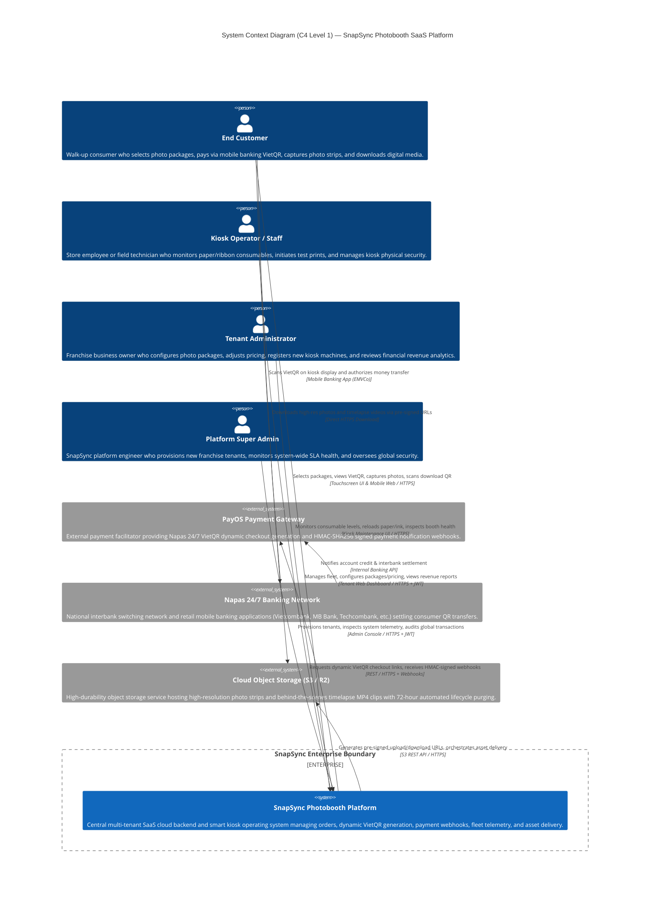

### System Context Elements

| Element | Type | Description | Communication Protocol |
| :--- | :--- | :--- | :--- |
| **SnapSync Platform** | Software System | The core software solution encapsulating the cloud SaaS backend, smart kiosk edge terminal software, and mobile asset retrieval web portal. | HTTPS, WSS |
| **End Customer** | Person | Retail consumer interacting directly with physical kiosks and scanning QR codes via mobile browser. | Physical Touchscreen, HTTPS |
| **Tenant Administrator** | Person | Franchise franchisee managing kiosk hardware, package pricing, and viewing accounting ledgers. | HTTPS / REST (JWT Auth) |
| **Kiosk Operator** | Person | Store technician or retail staff handling consumable replenishment and routine kiosk diagnostics. | Local Kiosk GUI / HTTPS |
| **Platform Super Admin** | Person | Platform operator managing tenant lifecycle and global platform security. | HTTPS / REST (Admin JWT) |
| **PayOS Gateway** | External System | Merchant payment facilitator bridging the platform to Vietnamese banking networks. | HTTPS REST API & Inbound Webhooks |
| **Napas 24/7 Network** | External System | National financial switch clearing bank transfers between retail banks and merchant accounts. | ISO 8583 / EMVCo VietQR standard |
| **Cloud Object Storage** | External System | AWS S3, Cloudflare R2, or local MinIO storage repository maintaining customer photo strips. | S3 REST API (Pre-Signed URLs) |

---

## 3.3 Container Diagram (C4 level 2)

The Container diagram decomposes the SnapSync platform into high-level executable processes, data stores, client applications, and external cloud services.

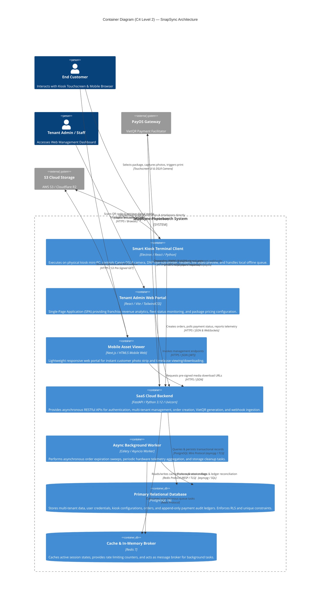

### Container Breakdown

| Container | Technology Stack | Responsibility | Data Stored | Protocols |
| :--- | :--- | :--- | :--- | :--- |
| **Smart Kiosk Terminal Client** | Electron, React, Python OpenCV / gPhoto2 | Runs on local kiosk PC. Drives camera capture, live display, physical dye-sub photo printing, and touchscreen workflow. | Local session state, hardware error logs, SQLite offline queue | HTTPS, WSS, USB (gPhoto2, CUPS) |
| **Tenant Admin Web Portal** | React 18, Vite, TypeScript, TailwindCSS | Single-Page Application for franchise owners and technicians to manage pricing, machines, and revenue ledgers. | Client-side JWT auth state, cached dashboard metrics | HTTPS, REST (JSON) |
| **Mobile Asset Viewer** | Next.js, HTML5 Mobile Web (PWA) | Clean mobile web experience scanned via QR code allowing customers to view and save photo strips and timelapses. | Ephemeral session download token in URL | HTTPS |
| **SaaS Cloud Backend** | Python 3.12, FastAPI, Uvicorn, Pydantic v2 | High-throughput asynchronous REST API server. Handles JWT RBAC, order creation, VietQR generation, and idempotent webhook processing. | Stateless (connection pools to DB and Redis) | HTTPS, WSS |
| **Async Background Worker** | Python 3.12, Celery / Asyncio Worker | Executes asynchronous cron sweeps for expired orders, consumable alerts, and external payment reconciliation. | Stateless queue worker | Redis RESP, PostgreSQL asyncpg |
| **Primary Database** | PostgreSQL 16 (Multi-AZ) | System of record. Houses multi-tenant schema, orders, machines, users, packages, payments, and immutable payment events. | Complete relational business state, ACID ledgers | TCP 5432 (asyncpg + SSL) |
| **In-Memory Cache & Broker** | Redis 7 | Transient high-speed caching of machine heartbeats, distributed rate limiting, and Celery task broker. | Ephemeral cache keys, pub/sub channels | TCP 6379 (RESP3) |
| **Cloud Object Storage** | AWS S3 / Cloudflare R2 / MinIO | Stores high-resolution photo composites (JPEG) and behind-the-scenes video timelapses (MP4) with 72h lifecycle purge. | Binary media objects | HTTPS (S3 API) |

---

## 3.4 Component Diagram

The Component diagram decomposes the **SaaS Cloud Backend Container (FastAPI)** into its internal modular software components, highlighting inbound request paths, security gates, domain logic, and persistence abstractions.

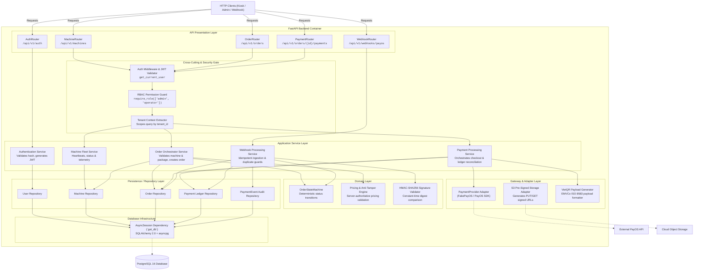

### Component Decomposition & Responsibilities

1. **API Routers (`api/v1/*.py`):**
   - Translate external HTTP payloads into Pydantic models.
   - Enforce HTTP status codes (`200 OK`, `201 Created`, `400 Bad Request`, `401 Unauthorized`, `403 Forbidden`, `404 Not Found`).
   - Completely free of raw SQL or business logic; delegate immediately to services.

2. **Security & Dependency Injection (`api/deps.py`, `core/security.py`):**
   - `get_current_user`: Decodes incoming `Authorization: Bearer <token>`, validates HMAC-SHA256 signature and expiration, and eager-loads user with associated tenant.
   - `require_role`: Higher-order dependency restricting access to specified roles (`['admin']`, `['admin', 'operator']`).
   - Prevents cross-tenant leakage by providing the caller's verified `tenant_id`.

3. **Application Services:**
   - **`Order Orchestrator Service`:** Validates machine operational availability (`machine.status == 'online'`), verifies package catalog validity, enforces server-authoritative pricing against client tampering, and retries unique `order_code` collisions using database savepoints.
   - **`Webhook Processing Service`:** Receives raw webhook payloads, computes and validates HMAC-SHA256 signatures, acquires pessimistic database row locks (`SELECT ... FOR UPDATE`), records immutable `PaymentEvent` entries, and executes safe state transitions.

4. **Domain Engines:**
   - **`OrderStateMachine` (`services/order_state.py`):** Pure deterministic state transition engine enforcing valid transitions (`PENDING -> PAID`, `PENDING -> EXPIRED`, etc.) and preventing illegal mutations on terminal states.
   - **`HMAC Signature Validator`:** Performs constant-time comparison (`hmac.compare_digest`) to protect against side-channel timing attacks.

5. **Repositories & Database Session Management:**
   - Manages asynchronous queries through SQLAlchemy 2.0 `select()` and `update()`.
   - `get_db`: Asynchronous generator yielding isolated transactional `AsyncSession` instances, automatically committing on success or rolling back on unhandled exceptions.

---

## 3.5 Deployment Diagram

The Deployment diagram models the physical and virtual nodes hosting the SnapSync platform, spanning edge kiosk hardware, cloud infrastructure inside an AWS/Cloudflare Virtual Private Cloud (VPC), and third-party payment and banking gateways.

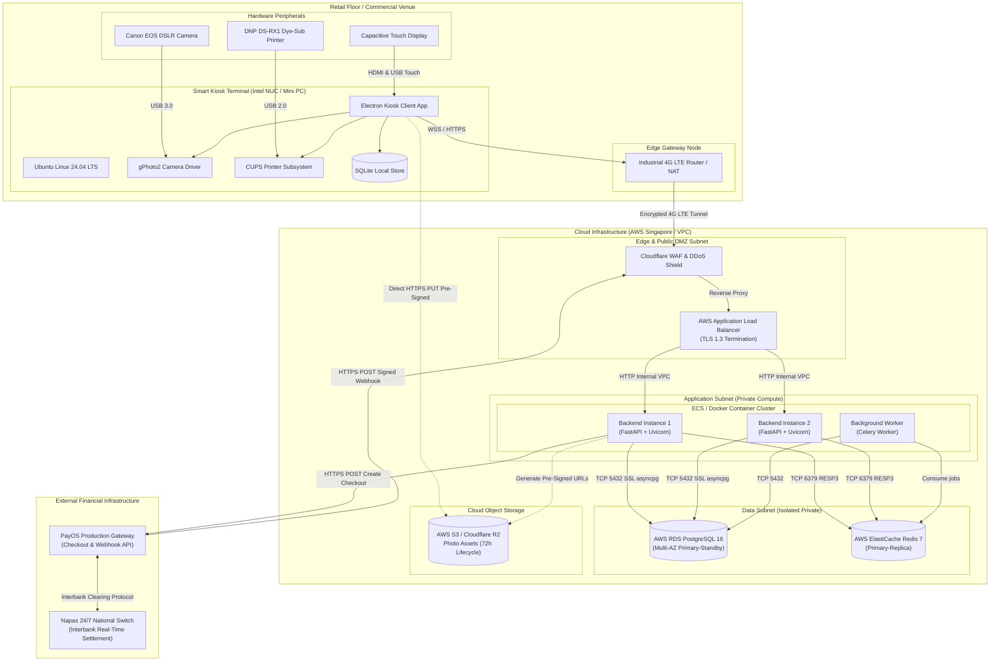

### Deployment Topology & Security Specifications

1. **Edge Retail Node (Smart Kiosk):**
   - Mini-PC (Intel Core i5, 16 GB RAM, 256 GB NVMe SSD) running hardened Ubuntu 24.04 LTS with read-only root partitions to survive abrupt power cuts.
   - DSLR camera controlled via `libgphoto2` over high-speed USB 3.0; dye-sublimation printer controlled via Linux CUPS raster driver.
   - Connected to cloud via dual-SIM industrial 4G LTE cellular router establishing an encrypted WireGuard VPN tunnel to the cloud VPC.

2. **Public DMZ & Ingress Tier:**
   - Cloudflare CDN provides enterprise DDoS mitigation, TLS 1.3 termination, and edge rate-limiting rules protecting `/api/v1/webhooks/payos` from volumetric HTTP floods.
   - AWS Application Load Balancer (ALB) balances traffic round-robin across healthy FastAPI backend container instances, executing synthetic health checks (`GET /health`) every 15 seconds.

3. **Application & Private Compute Tier:**
   - FastAPI backend services deployed in Docker containers managed via AWS ECS or lightweight Kubernetes.
   - Zero public IP addresses; services reside in private VPC subnets accessible solely via the load balancer.
   - Horizontal auto-scaling triggers when average CPU utilization exceeds 70% or active connection count crosses 1,200 per replica.

4. **Isolated Data Tier:**
   - Managed PostgreSQL 16 Multi-AZ deployment featuring automated synchronous replication to a standby instance in an alternate availability zone.
   - Data at rest encrypted via AWS KMS AES-256; data in transit encrypted via SSL/TLS certificates.
   - Redis cluster configured with AOF (Append-Only File) persistence for rate limiting and task coordination.

---

## 3.6 Architecture Decision Records

To capture architecturally significant choices made during the engineering lifecycle, the following four formal Architecture Decision Records (ADRs) have been established. Individual standalone markdown records are also permanently cataloged in `/docs/design/adr/`.

### ADR-001: Selection of FastAPI and Asynchronous SQLAlchemy 2.0 for High-Throughput Cloud Backend

| ADR Field | Details |
| :--- | :--- |
| **ADR** | **ADR-001: Selection of FastAPI and Asynchronous SQLAlchemy 2.0 for High-Throughput Cloud Backend** |
| **Status** | **Accepted** |
| **Context** | The platform serves two contrasting traffic patterns: high-frequency 2-second client status polling from hundreds of edge kiosks (`GET /api/v1/orders/{id}/payment-status`) and low-latency webhook ingestion from PayOS (`POST /api/v1/webhooks/payos`) which must complete in ≤ 150 ms (P99). Synchronous WSGI frameworks (Django, Flask) rely on worker process thread pools that quickly experience thread starvation under concurrent polling, causing latency spikes and high memory bloat. |
| **Decision** | Adopt **FastAPI** running on the **Uvicorn** ASGI web server, coupled with **SQLAlchemy 2.0 (Async Engine)** and **asyncpg** as the PostgreSQL driver. All route handlers and database operations are implemented as non-blocking coroutines (`async def`). Request validation and serialization are handled via **Pydantic v2** compiled in Rust. Dependency injection (`fastapi.Depends`) manages `AsyncSession` database lifecycles cleanly per request. |
| **Alternatives considered** | 1. **Django + Django REST Framework:** Robust batteries-included ORM and admin, but historically synchronous core; async ORM is still maturing; 3–5× higher P95 latency under concurrent I/O.<br>2. **Node.js + NestJS + Prisma:** Native async event loop, but diverges from Python-centric imaging/OpenCV pipelines; Prisma connection pool overhead in containers.<br>3. **Go + Gin / Fiber:** Exceptional raw throughput, but slower development velocity for complex multi-tenant ORM domain models; higher team ramp-up time. |
| **Consequences** | • Sustains > 1,500 req/sec per container with P95 latency < 50 ms.<br>• Native coroutines eliminate OS thread blocking during database round-trips and external payment gateway calls.<br>• Automatic OpenAPI/Swagger documentation generation accelerates client integration.<br>• *Trade-off:* Developers must prevent blocking synchronous operations (e.g. `time.sleep()`, synchronous `requests`) on the asyncio loop.<br>• *Trade-off:* SQLAlchemy requires explicit eager loading (`selectinload`) to avoid `MissingGreenlet` errors. |

---

### ADR-002: Dual-Table Ledger Architecture and Pessimistic Row Locking for Webhook Idempotency

| ADR Field | Details |
| :--- | :--- |
| **ADR** | **ADR-002: Dual-Table Ledger Architecture and Pessimistic Row Locking for Webhook Idempotency** |
| **Status** | **Accepted** |
| **Context** | External payment facilitators (PayOS, Napas 24/7) operate under an "at-least-once" delivery policy. Network jitter, gateway timeouts, or user retries cause identical payment webhooks to arrive concurrently (within milliseconds) or sequentially. Without strict idempotency guards, race conditions cause orders to be fulfilled twice, physical photo sessions to double-trigger, or financial audit records to become corrupt. |
| **Decision** | Implement a **Dual-Table Ledger Architecture** with **Database-Level Pessimistic Locking (`SELECT ... FOR UPDATE`)** and **Unique Reference Constraints**:<br>1. Separate outbound intent (`payments` table) from inbound immutable audit events (`payment_events` table).<br>2. Enforce composite unique constraint `UniqueConstraint("provider", "reference", name="uq_payment_events_provider_reference")` on PostgreSQL. Concurrent duplicate writes fail with `IntegrityError` (code 23505) and roll back safely.<br>3. Webhook worker locks target order via `SELECT * FROM orders WHERE order_code = :code FOR UPDATE`.<br>4. Guard transitions via deterministic `OrderStateMachine` (`PENDING -> PAID -> COMPLETED`). Re-transitions on `PAID` orders act as idempotent no-ops returning HTTP 200 OK. |
| **Alternatives considered** | 1. **Single-Table Mutation (Mutating `orders.status` directly):** Simpler schema, but zero immutable historical audit trail; impossible to reconstruct dispute logs or detect underpayments/overpayments.<br>2. **Distributed Redis Lock (Redlock):** Fast in-memory locking, but introduces distributed system split-brain failure modes; Redis is not the financial source of truth; database ACID locks guarantee absolute consistency.<br>3. **Application In-Memory Lock (`asyncio.Lock`):** Single-process only; fails across multi-worker Uvicorn configurations or horizontally scaled cloud replicas. |
| **Consequences** | • 100% mathematical guarantee of webhook idempotency and zero duplicate order fulfillment under concurrent bursts.<br>• Complete forensic audit trail preserving raw JSON payloads, signature validation booleans, timestamps, and error messages.<br>• Duplicate webhooks acknowledge with HTTP 200/202 `{ status: "DUPLICATE" }`, preventing external gateway retry storms.<br>• *Trade-off:* `SELECT ... FOR UPDATE` acquires a row lock for the transaction duration (~10–25 ms). Strict design rule: no external HTTP/network calls are permitted while holding the database transaction lock. |

---

### ADR-003: Shared Database Multi-Tenancy via Tenant Discriminator and JWT Claims

| ADR Field | Details |
| :--- | :--- |
| **ADR** | **ADR-003: Shared Database Multi-Tenancy via Tenant Discriminator and JWT Claims** |
| **Status** | **Accepted** |
| **Context** | SnapSync is a B2B SaaS platform serving independent photobooth franchise owners (tenants). Each tenant manages kiosks, pricing packages, revenue records, and staff users. Strict data isolation is mandated by business policy and data privacy laws: Tenant A must never view, mutate, or access records belonging to Tenant B. |
| **Decision** | Adopt **Shared Database with Tenant Discriminator Column (`tenant_id`)** combined with **Cryptographically Signed Stateless JWT Authentication and Role-Based Access Control (RBAC)**:<br>1. Every domain table (`users`, `machines`, `packages`, `orders`, `payments`, `payment_events`) includes `tenant_id UUID NOT NULL` referencing `tenants(id)` with `ON DELETE CASCADE`.<br>2. Composite B-tree indexes are created on `(tenant_id, created_at)`, `(tenant_id, status)`, and `(tenant_id, is_active)` across all operational tables.<br>3. Backend issues HMAC-SHA256 signed JWTs containing user `sub`, `tenant_id`, and `role` (`admin`, `operator`, `customer`).<br>4. FastAPI dependency injection (`require_role`, `get_current_user` in `app/api/deps.py`) inspects tokens and scopes all queries (`WHERE model.tenant_id == current_user.tenant_id`).<br>5. Unique machine codes are scoped per tenant via `UniqueConstraint("tenant_id", "machine_code")`. |
| **Alternatives considered** | 1. **Database-per-Tenant:** Maximum physical isolation, but prohibitive cloud database hosting costs for dozens of small franchise locations; complex connection pool management exhausting database connection limits.<br>2. **Schema-per-Tenant:** Logical separation, but Alembic schema migrations across hundreds of tenant schemas become slow and error-prone; PostgreSQL metadata bloat.<br>3. **PostgreSQL Row-Level Security (RLS) alone:** Secure, but dynamic session switching (`SET LOCAL app.current_tenant_id`) introduces connection pool hazards with `asyncpg` pooled connections. Primary enforcement at application ORM layer with RLS as defense-in-depth is superior. |
| **Consequences** | • Highly cost-effective infrastructure; single PostgreSQL instance supports hundreds of franchise tenants with minimal idle memory consumption.<br>• Unified database migrations: Alembic runs a single migration suite affecting all tenants simultaneously.<br>• Stateless JWTs allow horizontal backend scaling behind a load balancer without sticky sessions.<br>• *Trade-off:* Developers must ensure every new database query explicitly filters by `current_user.tenant_id`. Enforced through automated code reviews and standardized dependency injection. |

---

### ADR-004: Direct-to-Cloud Pre-Signed URLs and Ephemeral Media Storage for Asset Delivery

| ADR Field | Details |
| :--- | :--- |
| **ADR** | **ADR-004: Direct-to-Cloud Pre-Signed URLs and Ephemeral Media Storage for Asset Delivery** |
| **Status** | **Accepted** |
| **Context** | At the conclusion of a photo session, kiosks render high-resolution composite photo strips (1200x1800 dpi, ~8–12 MB) and behind-the-scenes timelapse MP4 video clips (~15–30 MB). Customers scan an on-screen QR code to download digital assets. Streaming large binary media through the FastAPI backend would saturate network bandwidth, consume worker threads, and trigger server connection starvation. Furthermore, Vietnam Decree 13/2023/ND-CP mandates that consumer biometric data must not be stored indefinitely. |
| **Decision** | Adopt **Direct-to-Cloud Ephemeral Storage using AWS S3 / Cloudflare R2 with Pre-Signed URLs**:<br>1. **Pre-Signed Upload URL (Kiosk -> Storage):** Kiosk captures media locally, requests a time-limited pre-signed `PUT` URL from backend (`GET /api/v1/orders/{id}/upload-url`), and uploads directly to S3 via HTTPS. The API server proxies 0 bytes of binary media.<br>2. **Ephemeral Pre-Signed Download URL (Customer Delivery):** Customer scans an on-screen QR code encoding a secure retrieval token. Backend verifies token and issues an HTTP 307 redirect to an S3 Pre-Signed `GET` URL valid for exactly 15 minutes.<br>3. **Automated Ephemeral Retention (72-Hour TTL):** S3 Bucket Lifecycle Policy permanently purges all stored media objects older than 72 hours (`Expiration: Days: 3`). |
| **Alternatives considered** | 1. **Backend Binary Proxy Streaming:** Complete control over HTTP headers, but severe backend bottleneck. Hundreds of simultaneous 30 MB downloads would crash ASGI workers.<br>2. **Public S3 Bucket with Obfuscated UUIDs:** Simple, but insecure. Anyone obtaining or guessing the link retains permanent access; violates Decree 13/2023/ND-CP.<br>3. **Self-Hosted Kiosk Web Server:** Zero cloud storage costs, but kiosks reside behind NAT/4G connections without public IPs; customers must connect to a local kiosk Wi-Fi hotspot, creating severe UX friction. |
| **Consequences** | • Offloads 100% of binary media transfer bandwidth and storage latency to high-speed cloud CDN edge storage.<br>• Pre-signed URLs enforce cryptographic access expiry without requiring walk-up customers to register accounts or expose phone numbers.<br>• 72-hour automated purge guarantees strict legal privacy compliance and eliminates recurring storage hosting costs.<br>• *Trade-off:* Kiosk software must handle direct S3 upload network failure retries independently. |

---

# 4. Object-Oriented Design

## 4.1 Domain Model

The Domain Model presents the conceptual business entities, their semantic relationships, and structural cardinalities within the SnapSync multi-tenant photobooth ecosystem. In accordance with conceptual modeling standards, methods and implementation attributes are omitted.

```mermaid
classDiagram
    title SnapSync Domain Model (Conceptual Class Diagram)

    class Tenant {
        +UUID id
        +String name
        +String code
        +Boolean is_active
        +DateTime created_at
        +DateTime updated_at
    }

    class User {
        +UUID id
        +UUID tenant_id
        +String username
        +String hashed_password
        +String full_name
        +String role
        +Boolean is_active
        +DateTime created_at
    }

    class Machine {
        +UUID id
        +UUID tenant_id
        +String machine_code
        +String name
        +String location
        +String status
        +Boolean is_active
        +DateTime created_at
    }

    class Package {
        +UUID id
        +UUID tenant_id
        +String name
        +Integer price_vnd
        +Integer duration_seconds
        +Boolean is_active
        +DateTime created_at
    }

    class Order {
        +UUID id
        +UUID tenant_id
        +UUID machine_id
        +UUID package_id
        +String order_code
        +BigInteger numeric_order_code
        +Integer amount_vnd
        +String status
        +String payment_method
        +DateTime expires_at
        +DateTime paid_at
        +DateTime created_at
    }

    class Payment {
        +UUID id
        +UUID tenant_id
        +UUID order_id
        +String provider
        +String payment_reference
        +String order_code
        +Integer amount_vnd
        +String status
        +String checkout_url
        +String qr_code
        +String account_number
        +String account_name
        +String bin
        +DateTime expires_at
        +DateTime created_at
    }

    class PaymentEvent {
        +UUID id
        +UUID tenant_id
        +UUID order_id
        +String provider
        +String reference
        +String order_code
        +Integer amount_vnd
        +String status
        +Boolean is_valid_signature
        +JSONB raw_payload
        +String error_message
        +DateTime created_at
    }

    class MediaAsset {
        +UUID id
        +UUID tenant_id
        +UUID order_id
        +String asset_type
        +String s3_key
        +String mime_type
        +Integer file_size_bytes
        +DateTime expires_at
        +DateTime created_at
    }

    %% Multi-Tenant Ownership (1 to Many)
    Tenant "1" *-- "0..*" User : employs / owns
    Tenant "1" *-- "0..*" Machine : deploys / operates
    Tenant "1" *-- "0..*" Package : configures / offers
    Tenant "1" *-- "0..*" Order : processes / records
    Tenant "1" *-- "0..*" Payment : initiates
    Tenant "1" *-- "0..*" PaymentEvent : audits

    %% Operational Relationships
    Machine "1" --> "0..*" Order : executes session for
    Package "1" --> "0..*" Order : establishes pricing for
    Order "1" *-- "0..*" Payment : generates outbound intent
    Order "1" *-- "0..*" PaymentEvent : records settlement events
    Order "1" *-- "0..*" MediaAsset : produces digital output
```

### Domain Model Invariants & Structural Rules
1. **Multi-Tenant Scoping:** Every domain entity is owned by exactly one `Tenant`. Cascading deletion of a Tenant cleanly purges all child records (`ON DELETE CASCADE`).
2. **Machine Code Tenant Uniqueness:** A `machine_code` (e.g. `BOOTH-01`) is unique within a specific tenant but may exist identically across different tenants.
3. **Immutable Price Snapshots:** When an `Order` is instantiated, its `amount_vnd` is snapshot from `Package.price_vnd`. Future adjustments to `Package.price_vnd` do not retroactively alter the financial balance of historical orders.
4. **Dual Ledger Correlation:** An `Order` owns zero-or-more `Payment` records (reflecting checkout attempts) and zero-or-more `PaymentEvent` records (reflecting external webhook receipts). Exactly one `PaymentEvent` with status `PROCESSED` transitions an order from `PENDING` to `PAID`.

---

## 4.2 Class Diagram

The Design-Level Class Diagram depicts software classes within the backend container, detailing attribute types, visibility scopes (`+` public, `-` private, `#` protected), operations with parameter and return types, and class relationships (generalization, composition, dependency).

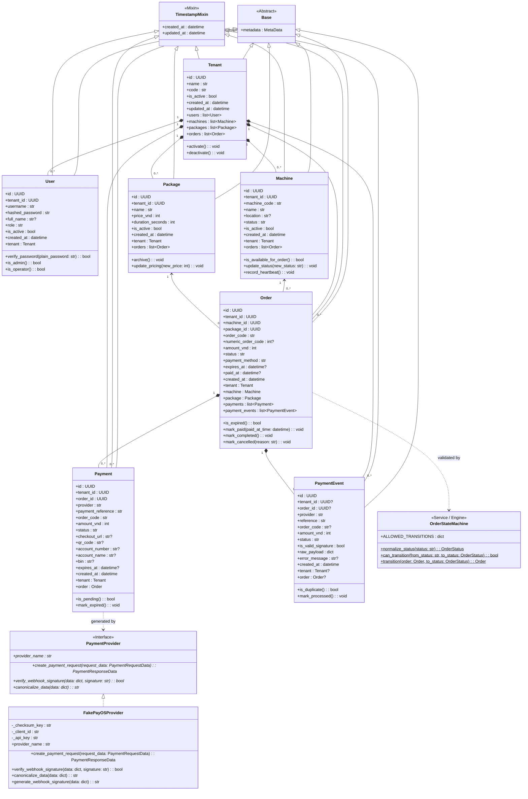

---

## 4.3 Class Specifications

The following specifications detail the 8 core domain and service classes implementing the architectural logic of the SnapSync platform.

### 4.3.1 Class C1: Tenant
- **Superclass:** `Base`, `TimestampMixin`
- **Responsibility:** Represents an isolated commercial franchise entity. Serves as the top-level multi-tenant security boundary and ownership root for users, machines, pricing packages, orders, and financial transactions.

#### Attribute Table
| # | Attribute | Type | Visibility | Constraint | Description |
| :--- | :--- | :--- | :--- | :--- | :--- |
| 1 | `id` | `uuid.UUID` | Public (`+`) | Primary Key, NOT NULL | Globally unique tenant identifier. |
| 2 | `name` | `str` | Public (`+`) | String(100), NOT NULL | Commercial business or franchise name. |
| 3 | `code` | `str` | Public (`+`) | String(50), UNIQUE, NOT NULL, INDEX | Human-readable unique tenant identifier (e.g. `PARADISO_VN`). |
| 4 | `is_active` | `bool` | Public (`+`) | Boolean, NOT NULL, DEFAULT True | Billing and account status flag. |
| 5 | `created_at` | `datetime` | Public (`+`) | TIMESTAMPTZ, NOT NULL | Record creation timestamp. |
| 6 | `updated_at` | `datetime` | Public (`+`) | TIMESTAMPTZ, NOT NULL | Last modification timestamp. |

#### Operation Table
| # | Operation | Parameters / Return | Visibility | Description |
| :--- | :--- | :--- | :--- | :--- |
| 1 | `activate` | `() -> void` | Public (`+`) | Re-enables franchise account, allowing machine operation and order creation. |
| 2 | `deactivate` | `() -> void` | Public (`+`) | Suspends tenant; immediately revokes API access and rejects order generation. |

---

### 4.3.2 Class C2: User
- **Superclass:** `Base`, `TimestampMixin`
- **Responsibility:** Represents an authenticated user account belonging to a specific tenant. Encapsulates credential storage, role definition (`admin`, `operator`, `customer`), and password verification.

#### Attribute Table
| # | Attribute | Type | Visibility | Constraint | Description |
| :--- | :--- | :--- | :--- | :--- | :--- |
| 1 | `id` | `uuid.UUID` | Public (`+`) | Primary Key, NOT NULL | Unique user identifier. |
| 2 | `tenant_id` | `uuid.UUID` | Public (`+`) | FK(`tenants.id`), NOT NULL, INDEX | Foreign key establishing tenant ownership (CASCADE). |
| 3 | `username` | `str` | Public (`+`) | String(50), UNIQUE, NOT NULL, INDEX | Globally unique login username. |
| 4 | `hashed_password` | `str` | Public (`+`) | String(255), NOT NULL | Passlib bcrypt-hashed password hash. |
| 5 | `full_name` | `str | None` | Public (`+`) | String(100), NULLABLE | Display name of the user. |
| 6 | `role` | `str` | Public (`+`) | String(20), CHECK(role IN ('admin', 'operator', 'customer')) | Role for RBAC authorization. |
| 7 | `is_active` | `bool` | Public (`+`) | Boolean, NOT NULL, DEFAULT True | Active user account flag. |

#### Operation Table
| # | Operation | Parameters / Return | Visibility | Description |
| :--- | :--- | :--- | :--- | :--- |
| 1 | `verify_password` | `(plain_password: str) -> bool` | Public (`+`) | Compares plain password against stored bcrypt hash using constant-time check. |
| 2 | `is_admin` | `() -> bool` | Public (`+`) | Returns `True` if `role == 'admin'`, unlocking administrative endpoints. |
| 3 | `is_operator` | `() -> bool` | Public (`+`) | Returns `True` if `role` is `'admin'` or `'operator'`. |

---

### 4.3.3 Class C3: Machine
- **Superclass:** `Base`, `TimestampMixin`
- **Responsibility:** Represents an unattended physical photobooth kiosk terminal. Tracks machine status (`online`, `offline`, `busy`, `maintenance`), geographic location, and operational readiness.

#### Attribute Table
| # | Attribute | Type | Visibility | Constraint | Description |
| :--- | :--- | :--- | :--- | :--- | :--- |
| 1 | `id` | `uuid.UUID` | Public (`+`) | Primary Key, NOT NULL | Unique machine identifier. |
| 2 | `tenant_id` | `uuid.UUID` | Public (`+`) | FK(`tenants.id`), NOT NULL, INDEX | Foreign key establishing tenant ownership. |
| 3 | `machine_code` | `str` | Public (`+`) | String(50), NOT NULL, UNIQUE(tenant_id, machine_code) | Kiosk hardware serial identifier within tenant. |
| 4 | `name` | `str` | Public (`+`) | String(100), NOT NULL | Friendly display name (e.g. "Aeon Mall Booth #01"). |
| 5 | `location` | `str | None` | Public (`+`) | String(255), NULLABLE | Physical installation venue address. |
| 6 | `status` | `str` | Public (`+`) | String(20), CHECK(status IN ('online', 'offline', 'busy', 'maintenance')) | Current machine operational state. |
| 7 | `is_active` | `bool` | Public (`+`) | Boolean, NOT NULL, DEFAULT True | Deployed/archived status flag. |

#### Operation Table
| # | Operation | Parameters / Return | Visibility | Description |
| :--- | :--- | :--- | :--- | :--- |
| 1 | `is_available_for_order` | `() -> bool` | Public (`+`) | Returns `True` if `is_active == True` and `status == 'online'`. |
| 2 | `update_status` | `(new_status: str) -> void` | Public (`+`) | Mutates machine status following valid hardware state rules. |
| 3 | `record_heartbeat` | `() -> void` | Public (`+`) | Updates `updated_at` timestamp confirming kiosk network connectivity. |

---

### 4.3.4 Class C4: Package
- **Superclass:** `Base`, `TimestampMixin`
- **Responsibility:** Represents a commercial photobooth product offering (e.g., "Classic 4-Cut Strip", "Wide 6-Cut Collage"). Enforces strict positive retail pricing and capture session durations.

#### Attribute Table
| # | Attribute | Type | Visibility | Constraint | Description |
| :--- | :--- | :--- | :--- | :--- | :--- |
| 1 | `id` | `uuid.UUID` | Public (`+`) | Primary Key, NOT NULL | Unique package identifier. |
| 2 | `tenant_id` | `uuid.UUID` | Public (`+`) | FK(`tenants.id`), NOT NULL, INDEX | Foreign key establishing tenant catalog ownership. |
| 3 | `name` | `str` | Public (`+`) | String(100), NOT NULL | Name of the photo package. |
| 4 | `price_vnd` | `int` | Public (`+`) | Integer, NOT NULL, CHECK(price_vnd > 0) | Retail price in Vietnamese Dong (VND). |
| 5 | `duration_seconds` | `int` | Public (`+`) | Integer, NOT NULL, CHECK(duration_seconds > 0) | Total touchscreen capture timer in seconds. |
| 6 | `is_active` | `bool` | Public (`+`) | Boolean, NOT NULL, DEFAULT True | Visibility flag for kiosk selection menus. |

#### Operation Table
| # | Operation | Parameters / Return | Visibility | Description |
| :--- | :--- | :--- | :--- | :--- |
| 1 | `archive` | `() -> void` | Public (`+`) | Soft-deletes package (`is_active = False`) to preserve historical order joins. |
| 2 | `update_pricing` | `(new_price: int) -> void` | Public (`+`) | Validates `new_price > 0` and updates package retail catalog amount. |

---

### 4.3.5 Class C5: Order
- **Superclass:** `Base`, `TimestampMixin`
- **Responsibility:** Represents a customer purchase transaction on a specific kiosk. Acts as the aggregate root for session execution, capturing authoritative pricing, state progression, and expiration windows.

#### Attribute Table
| # | Attribute | Type | Visibility | Constraint | Description |
| :--- | :--- | :--- | :--- | :--- | :--- |
| 1 | `id` | `uuid.UUID` | Public (`+`) | Primary Key, NOT NULL | Unique order identifier. |
| 2 | `tenant_id` | `uuid.UUID` | Public (`+`) | FK(`tenants.id`), NOT NULL, INDEX | Scoped tenant identifier. |
| 3 | `machine_id` | `uuid.UUID` | Public (`+`) | FK(`machines.id`), NOT NULL, INDEX | Kiosk machine processing the order (RESTRICT). |
| 4 | `package_id` | `uuid.UUID` | Public (`+`) | FK(`packages.id`), NOT NULL, INDEX | Selected package offering (RESTRICT). |
| 5 | `order_code` | `str` | Public (`+`) | String(50), UNIQUE, NOT NULL, INDEX | Public alphanumeric order identifier (e.g. `ORD-7K9W2B1X`). |
| 6 | `numeric_order_code` | `int | None` | Public (`+`) | BigInteger, UNIQUE, NULLABLE, INDEX | Numeric integer order code for legacy gateway compatibility. |
| 7 | `amount_vnd` | `int` | Public (`+`) | Integer, NOT NULL, CHECK(amount_vnd > 0) | Server-authoritative order price in VND. |
| 8 | `status` | `str` | Public (`+`) | String(20), NOT NULL, DEFAULT 'PENDING' | Current lifecycle status of the order. |
| 9 | `payment_method` | `str` | Public (`+`) | String(50), NOT NULL, DEFAULT 'qr_pay' | Payment rail identifier (`qr_pay`, `cash`, `pos`). |
| 10 | `expires_at` | `datetime | None` | Public (`+`) | TIMESTAMPTZ, NULLABLE | Expiration timestamp (created_at + 10 min). |
| 11 | `paid_at` | `datetime | None` | Public (`+`) | TIMESTAMPTZ, NULLABLE | Bank settlement timestamp. |

#### Operation Table
| # | Operation | Parameters / Return | Visibility | Description |
| :--- | :--- | :--- | :--- | :--- |
| 1 | `is_expired` | `() -> bool` | Public (`+`) | Checks if current UTC time exceeds `expires_at`. |
| 2 | `mark_paid` | `(paid_at_time: datetime) -> void` | Public (`+`) | Transitions status to `PAID` and stamps settlement timestamp. |
| 3 | `mark_completed` | `() -> void` | Public (`+`) | Transitions status to terminal `COMPLETED` post photo printing. |
| 4 | `mark_cancelled` | `(reason: str) -> void` | Public (`+`) | Transitions order to terminal `CANCELLED` state. |

---

### 4.3.6 Class C6: Payment
- **Superclass:** `Base`, `TimestampMixin`
- **Responsibility:** Tracks outbound payment checkout intent created for an order. Holds generated EMVCo VietQR strings, PayOS checkout URLs, and banking virtual account metadata.

#### Attribute Table
| # | Attribute | Type | Visibility | Constraint | Description |
| :--- | :--- | :--- | :--- | :--- | :--- |
| 1 | `id` | `uuid.UUID` | Public (`+`) | Primary Key, NOT NULL | Unique payment record identifier. |
| 2 | `tenant_id` | `uuid.UUID` | Public (`+`) | FK(`tenants.id`), NOT NULL, INDEX | Scoped tenant identifier. |
| 3 | `order_id` | `uuid.UUID` | Public (`+`) | FK(`orders.id`), NOT NULL, INDEX | Associated photobooth order. |
| 4 | `provider` | `str` | Public (`+`) | String(50), NOT NULL, DEFAULT 'fake_payos' | Payment facilitator gateway name. |
| 5 | `payment_reference` | `str` | Public (`+`) | String(100), NOT NULL, INDEX | External gateway payment link reference ID. |
| 6 | `order_code` | `str` | Public (`+`) | String(50), NOT NULL | Denormalized order code for rapid lookup. |
| 7 | `amount_vnd` | `int` | Public (`+`) | Integer, NOT NULL | Checkout requested amount in VND. |
| 8 | `status` | `str` | Public (`+`) | String(20), NOT NULL, DEFAULT 'PENDING' | Payment intent status (`PENDING`, `EXPIRED`, `SETTLED`). |
| 9 | `qr_code` | `str | None` | Public (`+`) | Text, NULLABLE | Raw EMVCo standardized VietQR payload string. |
| 10 | `checkout_url` | `str | None` | Public (`+`) | String(255), NULLABLE | Hosted gateway checkout URL. |
| 11 | `account_number` | `str | None` | Public (`+`) | String(50), NULLABLE | Beneficiary virtual bank account number. |
| 12 | `bin` | `str | None` | Public (`+`) | String(20), NULLABLE | Beneficiary bank Bank Identification Number (e.g. 970422). |
| 13 | `expires_at` | `datetime | None` | Public (`+`) | TIMESTAMPTZ, NULLABLE | Payment checkout link expiration timestamp. |

#### Operation Table
| # | Operation | Parameters / Return | Visibility | Description |
| :--- | :--- | :--- | :--- | :--- |
| 1 | `is_pending` | `() -> bool` | Public (`+`) | Returns `True` if payment intent is active and unexpired. |
| 2 | `mark_expired` | `() -> void` | Public (`+`) | Sets payment status to `EXPIRED`. |

---

### 4.3.7 Class C7: PaymentEvent
- **Superclass:** `Base`, `TimestampMixin`
- **Responsibility:** An immutable, append-only financial audit ledger recording every inbound webhook received from payment gateways. Serves as the primary concurrency defense barrier via unique constraint.

#### Attribute Table
| # | Attribute | Type | Visibility | Constraint | Description |
| :--- | :--- | :--- | :--- | :--- | :--- |
| 1 | `id` | `uuid.UUID` | Public (`+`) | Primary Key, NOT NULL | Unique audit event identifier. |
| 2 | `tenant_id` | `uuid.UUID | None` | Public (`+`) | FK(`tenants.id`), NULLABLE, INDEX | Tenant ID (nullable for unmatched payments). |
| 3 | `order_id` | `uuid.UUID | None` | Public (`+`) | FK(`orders.id`), NULLABLE, INDEX | Order ID (nullable for unmatched payments). |
| 4 | `provider` | `str` | Public (`+`) | String(50), NOT NULL | Payment provider name (`fake_payos`, `payos`). |
| 5 | `reference` | `str` | Public (`+`) | String(100), NOT NULL | Gateway transaction reference ID. |
| 6 | `order_code` | `str | None` | Public (`+`) | String(50), NULLABLE, INDEX | Order code transmitted in webhook payload. |
| 7 | `amount_vnd` | `int` | Public (`+`) | Integer, NOT NULL | Actual settled money amount reported by bank. |
| 8 | `status` | `str` | Public (`+`) | String(30), NOT NULL | `PROCESSED`, `DUPLICATE`, `FLAGGED_FOR_REVIEW`, `LATE_PAYMENT`, `UNMATCHED`, `REJECTED`. |
| 9 | `is_valid_signature` | `bool` | Public (`+`) | Boolean, NOT NULL | True if webhook passed HMAC-SHA256 signature verification. |
| 10 | `raw_payload` | `dict` | Public (`+`) | JSONB, NOT NULL | Complete, unmodified raw JSON webhook body. |
| 11 | `error_message` | `str | None` | Public (`+`) | Text, NULLABLE | Descriptive diagnostic log for anomalies or validation failures. |

#### Operation Table
| # | Operation | Parameters / Return | Visibility | Description |
| :--- | :--- | :--- | :--- | :--- |
| 1 | `is_duplicate` | `() -> bool` | Public (`+`) | Returns `True` if `status == 'DUPLICATE'`. |
| 2 | `mark_processed` | `() -> void` | Public (`+`) | Sets event status to `PROCESSED` upon successful state machine execution. |

---

### 4.3.8 Class C8: OrderStateMachine
- **Superclass:** None (Domain Service / Engine)
- **Responsibility:** Enforces deterministic lifecycle state transitions for `Order` instances, mathematically eliminating illegal state jumps, double-settlement, and race-condition data corruption.

#### Attribute Table
| # | Attribute | Type | Visibility | Constraint | Description |
| :--- | :--- | :--- | :--- | :--- | :--- |
| 1 | `ALLOWED_TRANSITIONS` | `dict[OrderStatus, set[OrderStatus]]` | Public (`+`) | Static Constant Class Attribute | Adjacency matrix of permitted order state transitions. |

#### Operation Table
| # | Operation | Parameters / Return | Visibility | Description |
| :--- | :--- | :--- | :--- | :--- |
| 1 | `normalize_status` | `(status: str) -> OrderStatus` | Public (`+$`) | Converts case-insensitive string into strongly-typed `OrderStatus` enum. |
| 2 | `can_transition` | `(from_status: str, to_status: OrderStatus) -> bool` | Public (`+$`) | Queries transition matrix to verify if proposed step is legally permitted. |
| 3 | `transition` | `(order: Order, to_status: OrderStatus) -> Order` | Public (`+$`) | Validates transition legality, updates `order.status`, or raises `InvalidOrderStateTransitionError`. Handles identical state transitions idempotently. |

---

## 4.4 Sequence Diagrams

### 4.4.1 SD-01: User Authentication & JWT Issuance (UC-01)
Demonstrates user credential verification, password hash comparison, tenant active check, and HMAC-SHA256 JWT generation with conditional rejection alternatives.

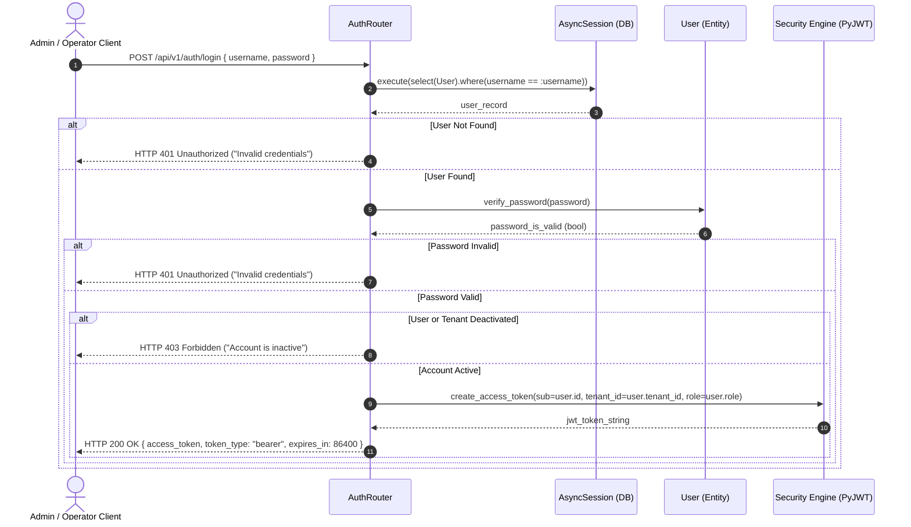

---

### 4.4.2 SD-02: Create Photobooth Order & Generate VietQR (UC-03)
Details the kiosk order creation flow, server-authoritative anti-tamper price enforcement, unique order code collision retry, and VietQR generation.

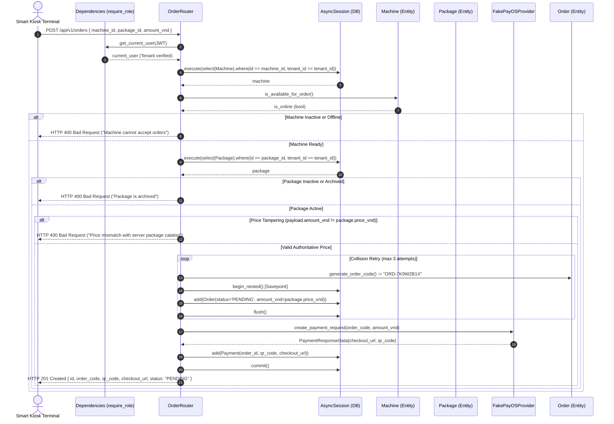

---

### 4.4.3 SD-03: Process Payment Webhook Idempotently with Concurrency Guards (UC-04)
Demonstrates the arrival of two identical concurrent webhooks via `par` fragment, signature verification, pessimistic locking (`SELECT ... FOR UPDATE`), PostgreSQL unique constraint defense, and deterministic state transitions.

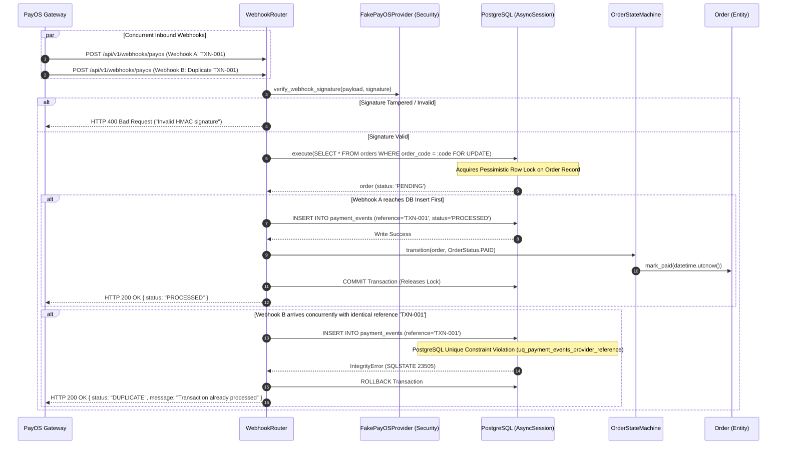

---

### 4.4.4 SD-04: Poll Payment Status & Unlock Kiosk Session (UC-05)
Demonstrates high-frequency kiosk status polling, database status inspection, and session unlocking.

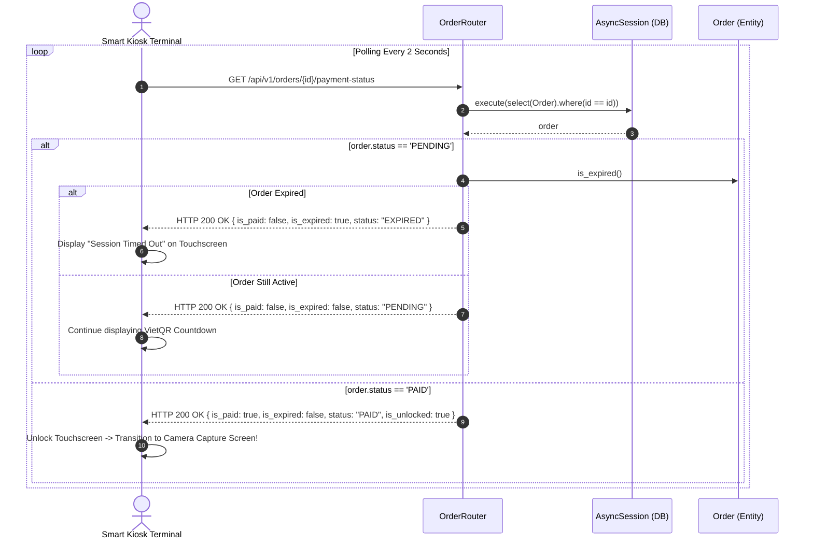

---

### 4.4.5 SD-05: Deliver Digital Assets via Pre-Signed URL (UC-07)
Demonstrates the secure handoff of digital photos from kiosk to S3, and mobile retrieval via pre-signed URL.

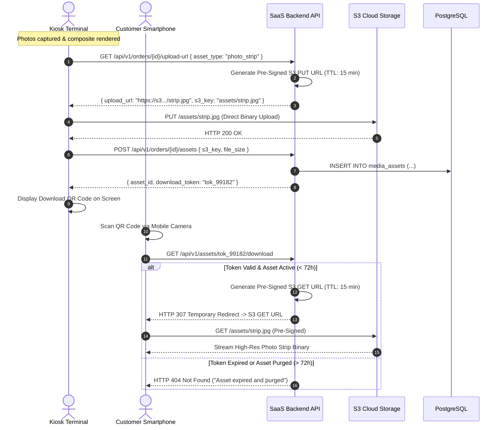

---

## 4.5 State Machine Diagrams

### 4.5.1 Order Lifecycle State Machine
The state of an `Order` governs kiosk hardware actions, payment acceptance, and accounting ledger reconciliations.

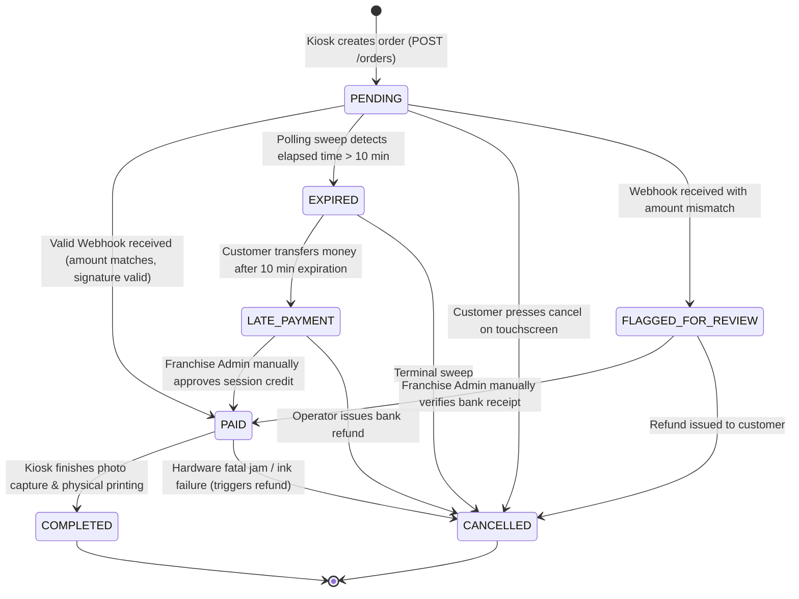

#### Order State Machine Transition Matrix

| Current State | Proposed State | Trigger / Guard Condition | System Action / Side Effect |
| :--- | :--- | :--- | :--- |
| `PENDING` | `PAID` | Webhook signature valid AND `webhook_amount == order.amount_vnd` AND `now < order.expires_at` | Sets `order.paid_at`, marks `PaymentEvent` as `PROCESSED`, unlocks kiosk. |
| `PENDING` | `FLAGGED_FOR_REVIEW` | Webhook signature valid AND `webhook_amount != order.amount_vnd` | Marks `PaymentEvent` as `FLAGGED_FOR_REVIEW`, alerts franchise admin. |
| `PENDING` | `EXPIRED` | System time > `order.expires_at` (10 minutes elapsed) | Disables active VietQR code on kiosk display. |
| `PENDING` | `CANCELLED` | Customer presses cancel OR kiosk hardware disconnects | Releases machine state to `online`. |
| `EXPIRED` | `LATE_PAYMENT` | Webhook arrives referencing expired order | Logs audit event with status `LATE_PAYMENT`, flags for human review. |
| `PAID` | `COMPLETED` | Kiosk reports print job successfully finished | Increments kiosk print counter, ends transaction lifecycle. |
| `COMPLETED` | *None* | Terminal state; no transitions permitted | N/A |
| `CANCELLED` | *None* | Terminal state; no transitions permitted | N/A |

---

### 4.5.2 Machine Operational State Machine
Represents the operational availability and hardware readiness of a physical photobooth kiosk terminal.

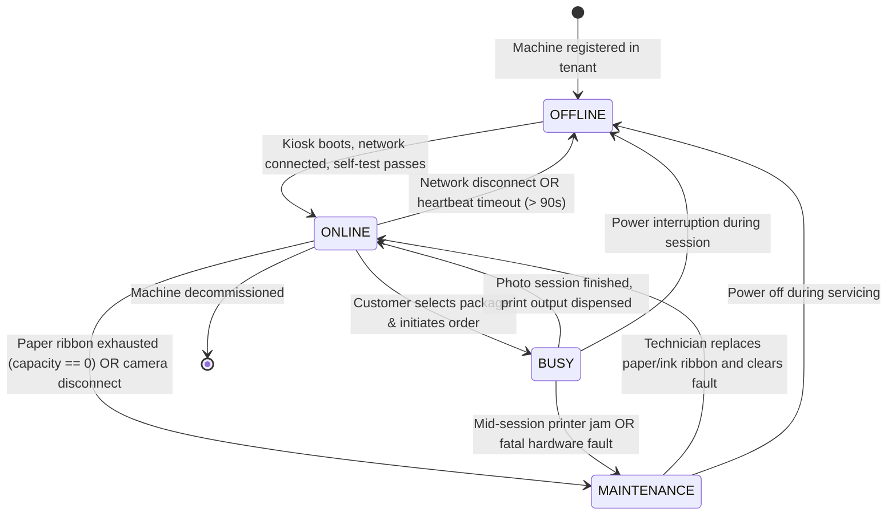

---

## 4.6 Design Principles and Patterns

The following table summarizes the key software engineering principles (SOLID) and Gang of Four (GoF) / Enterprise Integration patterns applied across the SnapSync architecture.

| Principle / Pattern | Where Applied in SnapSync | Architectural Rationale & Benefit |
| :--- | :--- | :--- |
| **Strategy Pattern (GoF)** | `PaymentProvider` interface, `FakePayOSProvider`, and `PayOSProvider` in `app/services/payment/` | Encapsulates payment gateway algorithms behind a uniform interface. Enables seamless switching between simulated local checkout (`FakePayOSProvider`) for automated CI testing and real payment facilitators (`PayOSProvider`, `MoMo`) in production without altering order orchestration logic. |
| **State Pattern / Finite State Machine** | `OrderStateMachine` in `app/services/order_state.py` | Eliminates tangled, error-prone `if/else` checks across API routers. Enforces deterministic lifecycle transitions, preventing illegal mutations (e.g. re-opening a cancelled order or double-fulfilling a paid order). |
| **Dependency Injection Pattern** | FastAPI `Depends(get_db)` and `Depends(require_role)` | Decouples route handlers from concrete database session lifecycles, authentication decoders, and role verifiers. Simplifies mocking in automated unit and integration tests. |
| **Repository & Data Mapper Pattern** | SQLAlchemy 2.0 Declarative Models and Async Repositories | Isolates domain entities from low-level SQL syntax and dialect specifics. Prevents SQL injection vulnerabilities via parameterized queries and handles connection pool checkout/release cleanly. |
| **Idempotent Consumer & Ledger Pattern** | Dual-table ledger (`payments` and `payment_events`) with PostgreSQL unique constraint | Guarantees safe processing of at-least-once webhook deliveries. Automatically absorbs and deduplicates identical concurrent webhook bursts, recording a permanent forensic ledger for accounting auditability. |
| **Direct-to-Cloud Pre-Signed Handoff** | S3 Pre-Signed `PUT` and `GET` URLs in `AssetDeliveryService` | Offloads heavy binary file streaming (10 MB photos, 25 MB timelapses) directly to cloud object storage. Protects FastAPI backend worker threads and bandwidth from saturation. |
| **Single Responsibility Principle (SRP)** | Segregation of API Routers, Orchestrator Services, Domain State Machines, and DB Models | Routers handle HTTP translation; Services coordinate workflows; State Machines enforce transition rules; Models represent schema. Each module has exactly one reason to change. |
| **Open/Closed Principle (OCP)** | Adding new payment providers (e.g., ZaloPay, VNPay) | New payment gateways are introduced by sub-classing `PaymentProvider` without modifying existing `Order` models or order creation routers. |
| **Liskov Substitution Principle (LSP)** | `FakePayOSProvider` substituting `PaymentProvider` | Test suites run against `FakePayOSProvider` interchangeably with production gateways, generating identical HMAC signatures and canonical strings without altering caller behavior. |
| **Interface Segregation Principle (ISP)** | Pydantic Request/Response Schemas (`OrderCreateRequest`, `OrderResponse`, `OrderStatusUpdate`) | Clients are only exposed to the fields necessary for their specific operation. Prevents leaking internal database keys, password hashes, or administrative flags. |
| **Dependency Inversion Principle (DIP)** | Business logic depends on abstractions (`PaymentProvider`, `AsyncSession`), not concrete network implementations | High-level business policies do not depend on low-level database drivers or third-party HTTP clients. |

---

# 5. Data Design

## 5.1 Data Diagram (Entity-Relationship Diagram)

The following physical Entity-Relationship Diagram (ERD) defines the relational database schema implemented in PostgreSQL 16. It details all primary keys, foreign keys, column data types, constraints, and relationship cardinalities.

```mermaid
erDiagram
    tenants ||--o{ users : "employs"
    tenants ||--o{ machines : "operates"
    tenants ||--o{ packages : "configures"
    tenants ||--o{ orders : "processes"
    tenants ||--o{ payments : "initiates"
    tenants ||--o{ payment_events : "audits"
    tenants ||--o{ media_assets : "owns"

    machines ||--o{ orders : "executes"
    packages ||--o{ orders : "defines"
    orders ||--o{ payments : "generates"
    orders ||--o{ payment_events : "reconciles"
    orders ||--o{ media_assets : "produces"

    tenants {
        uuid id PK
        varchar_100 name
        varchar_50 code UK
        boolean is_active
        timestamptz created_at
        timestamptz updated_at
    }

    users {
        uuid id PK
        uuid tenant_id FK
        varchar_50 username UK
        varchar_255 hashed_password
        varchar_100 full_name
        varchar_20 role
        boolean is_active
        timestamptz created_at
        timestamptz updated_at
    }

    machines {
        uuid id PK
        uuid tenant_id FK
        varchar_50 machine_code
        varchar_100 name
        varchar_255 location
        varchar_20 status
        boolean is_active
        timestamptz created_at
        timestamptz updated_at
    }

    packages {
        uuid id PK
        uuid tenant_id FK
        varchar_100 name
        integer price_vnd
        integer duration_seconds
        boolean is_active
        timestamptz created_at
        timestamptz updated_at
    }

    orders {
        uuid id PK
        uuid tenant_id FK
        uuid machine_id FK
        uuid package_id FK
        varchar_50 order_code UK
        bigint numeric_order_code UK
        integer amount_vnd
        varchar_20 status
        varchar_50 payment_method
        timestamptz expires_at
        timestamptz paid_at
        timestamptz created_at
        timestamptz updated_at
    }

    payments {
        uuid id PK
        uuid tenant_id FK
        uuid order_id FK
        varchar_50 provider
        varchar_100 payment_reference
        varchar_50 order_code
        integer amount_vnd
        varchar_20 status
        text qr_code
        varchar_255 checkout_url
        varchar_50 account_number
        varchar_100 account_name
        varchar_20 bin
        timestamptz expires_at
        timestamptz created_at
        timestamptz updated_at
    }

    payment_events {
        uuid id PK
        uuid tenant_id FK
        uuid order_id FK
        varchar_50 provider
        varchar_100 reference
        varchar_50 order_code
        integer amount_vnd
        varchar_30 status
        boolean is_valid_signature
        jsonb raw_payload
        text error_message
        timestamptz created_at
        timestamptz updated_at
    }

    media_assets {
        uuid id PK
        uuid tenant_id FK
        uuid order_id FK
        varchar_50 asset_type
        varchar_255 s3_key
        varchar_50 mime_type
        integer file_size_bytes
        varchar_100 download_token UK
        timestamptz expires_at
        timestamptz created_at
        timestamptz updated_at
    }
```

---

## 5.2 Data Specification

### 5.2.1 Table: `tenants`
Stores isolated franchise merchant accounts operating on the platform.

| Table | Column | Data type | Constraints | Description |
| :--- | :--- | :--- | :--- | :--- |
| `tenants` | `id` | `UUID` | PRIMARY KEY, NOT NULL, DEFAULT uuid_generate_v4() | Globally unique tenant identifier. |
| `tenants` | `name` | `VARCHAR(100)` | NOT NULL | Commercial name of the franchise business. |
| `tenants` | `code` | `VARCHAR(50)` | UNIQUE, NOT NULL, INDEX | Human-readable identifier (e.g. `PARADISO_VN`). |
| `tenants` | `is_active` | `BOOLEAN` | NOT NULL, DEFAULT TRUE | Status flag; deactivation blocks all tenant traffic. |
| `tenants` | `created_at` | `TIMESTAMPTZ` | NOT NULL, DEFAULT NOW() | Timestamp when tenant was provisioned. |
| `tenants` | `updated_at` | `TIMESTAMPTZ` | NOT NULL, DEFAULT NOW() | Timestamp when tenant was last modified. |

---

### 5.2.2 Table: `users`
Stores user accounts, bcrypt hashed credentials, and role assignments.

| Table | Column | Data type | Constraints | Description |
| :--- | :--- | :--- | :--- | :--- |
| `users` | `id` | `UUID` | PRIMARY KEY, NOT NULL, DEFAULT uuid_generate_v4() | Unique user identifier. |
| `users` | `tenant_id` | `UUID` | FK(`tenants.id` ON DELETE CASCADE), NOT NULL, INDEX | Scoped franchise tenant. |
| `users` | `username` | `VARCHAR(50)` | UNIQUE, NOT NULL, INDEX | Globally unique username for direct login. |
| `users` | `hashed_password` | `VARCHAR(255)` | NOT NULL | Passlib bcrypt password hash. |
| `users` | `full_name` | `VARCHAR(100)` | NULLABLE | Display full name of user. |
| `users` | `role` | `VARCHAR(20)` | NOT NULL, DEFAULT 'operator', CHECK(`role IN ('admin', 'operator', 'customer')`) | Role for RBAC authorization. |
| `users` | `is_active` | `BOOLEAN` | NOT NULL, DEFAULT TRUE | User active flag. |
| `users` | `created_at` | `TIMESTAMPTZ` | NOT NULL, DEFAULT NOW() | Record creation timestamp. |
| `users` | `updated_at` | `TIMESTAMPTZ` | NOT NULL, DEFAULT NOW() | Record modification timestamp. |

---

### 5.2.3 Table: `machines`
Tracks physical photobooth kiosks, locations, and hardware operational status.

| Table | Column | Data type | Constraints | Description |
| :--- | :--- | :--- | :--- | :--- |
| `machines` | `id` | `UUID` | PRIMARY KEY, NOT NULL, DEFAULT uuid_generate_v4() | Unique kiosk machine identifier. |
| `machines` | `tenant_id` | `UUID` | FK(`tenants.id` ON DELETE CASCADE), NOT NULL, INDEX | Scoped franchise tenant. |
| `machines` | `machine_code` | `VARCHAR(50)` | NOT NULL, INDEX | Hardware serial code. Unique per tenant (`uq_tenant_machine_code`). |
| `machines` | `name` | `VARCHAR(100)` | NOT NULL | Friendly display name of kiosk. |
| `machines` | `location` | `VARCHAR(255)` | NULLABLE | Physical installation location. |
| `machines` | `status` | `VARCHAR(20)` | NOT NULL, DEFAULT 'online', CHECK(`status IN ('online', 'offline', 'busy', 'maintenance')`) | Machine operational status. |
| `machines` | `is_active` | `BOOLEAN` | NOT NULL, DEFAULT TRUE | Deployment visibility flag. |
| `machines` | `created_at` | `TIMESTAMPTZ` | NOT NULL, DEFAULT NOW() | Record creation timestamp. |
| `machines` | `updated_at` | `TIMESTAMPTZ` | NOT NULL, DEFAULT NOW() | Record modification timestamp. |

---

### 5.2.4 Table: `packages`
Maintains commercial photo packages, retail prices, and session capture durations.

| Table | Column | Data type | Constraints | Description |
| :--- | :--- | :--- | :--- | :--- |
| `packages` | `id` | `UUID` | PRIMARY KEY, NOT NULL, DEFAULT uuid_generate_v4() | Unique package identifier. |
| `packages` | `tenant_id` | `UUID` | FK(`tenants.id` ON DELETE CASCADE), NOT NULL, INDEX | Scoped franchise tenant. |
| `packages` | `name` | `VARCHAR(100)` | NOT NULL | Photo package title (e.g. "Standard 4-Cut"). |
| `packages` | `price_vnd` | `INTEGER` | NOT NULL, CHECK(`price_vnd > 0`) | Retail price in Vietnamese Dong. |
| `packages` | `duration_seconds` | `INTEGER` | NOT NULL, DEFAULT 300, CHECK(`duration_seconds > 0`) | Interactive capture duration in seconds. |
| `packages` | `is_active` | `BOOLEAN` | NOT NULL, DEFAULT TRUE | Catalog visibility flag. |
| `packages` | `created_at` | `TIMESTAMPTZ` | NOT NULL, DEFAULT NOW() | Record creation timestamp. |
| `packages` | `updated_at` | `TIMESTAMPTZ` | NOT NULL, DEFAULT NOW() | Record modification timestamp. |

---

### 5.2.5 Table: `orders`
Aggregate root recording customer photobooth transactions, authoritative pricing, and state progression.

| Table | Column | Data type | Constraints | Description |
| :--- | :--- | :--- | :--- | :--- |
| `orders` | `id` | `UUID` | PRIMARY KEY, NOT NULL, DEFAULT uuid_generate_v4() | Unique order identifier. |
| `orders` | `tenant_id` | `UUID` | FK(`tenants.id` ON DELETE CASCADE), NOT NULL, INDEX | Scoped franchise tenant. |
| `orders` | `machine_id` | `UUID` | FK(`machines.id` ON DELETE RESTRICT), NOT NULL, INDEX | Associated kiosk machine. |
| `orders` | `package_id` | `UUID` | FK(`packages.id` ON DELETE RESTRICT), NOT NULL, INDEX | Selected package offering. |
| `orders` | `order_code` | `VARCHAR(50)` | UNIQUE, NOT NULL, INDEX | Public alphanumeric code (`ORD-7K9W2B1X`). |
| `orders` | `numeric_order_code` | `BIGINT` | UNIQUE, NULLABLE, INDEX | Numeric integer code for legacy gateways. |
| `orders` | `amount_vnd` | `INTEGER` | NOT NULL, CHECK(`amount_vnd > 0`) | Server-authoritative order price in VND. |
| `orders` | `status` | `VARCHAR(20)` | NOT NULL, DEFAULT 'pending', CHECK(`status IN ('PENDING', 'PAID', 'COMPLETED', 'CANCELLED', 'EXPIRED', 'LATE_PAYMENT', 'FLAGGED_FOR_REVIEW', 'pending', 'completed', 'cancelled')`) | Order state machine status. |
| `orders` | `payment_method` | `VARCHAR(50)` | NOT NULL, DEFAULT 'qr_pay' | Payment rail identifier (`qr_pay`, `cash`). |
| `orders` | `expires_at` | `TIMESTAMPTZ` | NULLABLE | Payment expiration window timestamp. |
| `orders` | `paid_at` | `TIMESTAMPTZ` | NULLABLE | Bank settlement timestamp. |
| `orders` | `created_at` | `TIMESTAMPTZ` | NOT NULL, DEFAULT NOW() | Record creation timestamp. |
| `orders` | `updated_at` | `TIMESTAMPTZ` | NOT NULL, DEFAULT NOW() | Record modification timestamp. |

---

### 5.2.6 Table: `payments`
Tracks outbound checkout link generation and Napas 24/7 VietQR strings.

| Table | Column | Data type | Constraints | Description |
| :--- | :--- | :--- | :--- | :--- |
| `payments` | `id` | `UUID` | PRIMARY KEY, NOT NULL, DEFAULT uuid_generate_v4() | Unique payment record identifier. |
| `payments` | `tenant_id` | `UUID` | FK(`tenants.id` ON DELETE CASCADE), NOT NULL, INDEX | Scoped franchise tenant. |
| `payments` | `order_id` | `UUID` | FK(`orders.id` ON DELETE CASCADE), NOT NULL, INDEX | Associated photobooth order. |
| `payments` | `provider` | `VARCHAR(50)` | NOT NULL, DEFAULT 'fake_payos' | Payment gateway name. |
| `payments` | `payment_reference` | `VARCHAR(100)` | NOT NULL, INDEX | Gateway payment link reference ID. |
| `payments` | `order_code` | `VARCHAR(50)` | NOT NULL | Denormalized order code for fast indexing. |
| `payments` | `amount_vnd` | `INTEGER` | NOT NULL | Checkout requested amount. |
| `payments` | `status` | `VARCHAR(20)` | NOT NULL, DEFAULT 'PENDING' | Payment intent status. |
| `payments` | `checkout_url` | `VARCHAR(255)` | NULLABLE | Gateway hosted payment link. |
| `payments` | `qr_code` | `TEXT` | NULLABLE | Raw EMVCo VietQR standardized string. |
| `payments` | `account_number` | `VARCHAR(50)` | NULLABLE | Beneficiary virtual account number. |
| `payments` | `account_name` | `VARCHAR(100)` | NULLABLE | Beneficiary account title. |
| `payments` | `bin` | `VARCHAR(20)` | NULLABLE | Beneficiary bank identification number. |
| `payments` | `expires_at` | `TIMESTAMPTZ` | NULLABLE | QR payment expiration timestamp. |
| `payments` | `created_at` | `TIMESTAMPTZ` | NOT NULL, DEFAULT NOW() | Record creation timestamp. |
| `payments` | `updated_at` | `TIMESTAMPTZ` | NOT NULL, DEFAULT NOW() | Record modification timestamp. |

---

### 5.2.7 Table: `payment_events`
Immutable append-only ledger storing every inbound webhook payload from payment gateways.

| Table | Column | Data type | Constraints | Description |
| :--- | :--- | :--- | :--- | :--- |
| `payment_events` | `id` | `UUID` | PRIMARY KEY, NOT NULL, DEFAULT uuid_generate_v4() | Unique audit event identifier. |
| `payment_events` | `tenant_id` | `UUID` | FK(`tenants.id` ON DELETE SET NULL), NULLABLE, INDEX | Scoped tenant (null if unmatched). |
| `payment_events` | `order_id` | `UUID` | FK(`orders.id` ON DELETE SET NULL), NULLABLE, INDEX | Associated order (null if unmatched). |
| `payment_events` | `provider` | `VARCHAR(50)` | NOT NULL | Gateway provider name. |
| `payment_events` | `reference` | `VARCHAR(100)` | NOT NULL, UNIQUE(`provider`, `reference`) | External gateway transaction reference ID. Critical idempotency barrier. |
| `payment_events` | `order_code` | `VARCHAR(50)` | NULLABLE, INDEX | Order code reported by webhook. |
| `payment_events` | `amount_vnd` | `INTEGER` | NOT NULL | Settled transfer amount in VND. |
| `payment_events` | `status` | `VARCHAR(30)` | NOT NULL | `PROCESSED`, `DUPLICATE`, `FLAGGED_FOR_REVIEW`, `LATE_PAYMENT`, `UNMATCHED`, `REJECTED`. |
| `payment_events` | `is_valid_signature` | `BOOLEAN` | NOT NULL | True if passed HMAC-SHA256 verification. |
| `payment_events` | `raw_payload` | `JSONB` | NOT NULL | Unmodified raw JSON webhook request body. |
| `payment_events` | `error_message` | `TEXT` | NULLABLE | Diagnostic reason for failure or anomaly. |
| `payment_events` | `created_at` | `TIMESTAMPTZ` | NOT NULL, DEFAULT NOW() | Timestamp webhook was received. |
| `payment_events` | `updated_at` | `TIMESTAMPTZ` | NOT NULL, DEFAULT NOW() | Last update timestamp. |

---

### 5.2.8 Table: `media_assets`
Maintains references to rendered photo composites and timelapses stored in cloud object storage.

| Table | Column | Data type | Constraints | Description |
| :--- | :--- | :--- | :--- | :--- |
| `media_assets` | `id` | `UUID` | PRIMARY KEY, NOT NULL, DEFAULT uuid_generate_v4() | Unique asset identifier. |
| `media_assets` | `tenant_id` | `UUID` | FK(`tenants.id` ON DELETE CASCADE), NOT NULL, INDEX | Scoped franchise tenant. |
| `media_assets` | `order_id` | `UUID` | FK(`orders.id` ON DELETE CASCADE), NOT NULL, INDEX | Associated photobooth order. |
| `media_assets` | `asset_type` | `VARCHAR(50)` | NOT NULL, CHECK(`asset_type IN ('photo_strip', 'timelapse_video', 'raw_frame')`) | Media categorization. |
| `media_assets` | `s3_key` | `VARCHAR(255)` | NOT NULL | Object storage path key (`assets/tenant_id/order_id/strip.jpg`). |
| `media_assets` | `mime_type` | `VARCHAR(50)` | NOT NULL | MIME classification (`image/jpeg`, `video/mp4`). |
| `media_assets` | `file_size_bytes` | `INTEGER` | NOT NULL | Binary file size in bytes. |
| `media_assets` | `download_token` | `VARCHAR(100)` | UNIQUE, NOT NULL, INDEX | Random URL token used for customer mobile QR handoff. |
| `media_assets` | `expires_at` | `TIMESTAMPTZ` | NOT NULL | Automatic purge deadline (created_at + 72 hours). |
| `media_assets` | `created_at` | `TIMESTAMPTZ` | NOT NULL, DEFAULT NOW() | Record creation timestamp. |
| `media_assets` | `updated_at` | `TIMESTAMPTZ` | NOT NULL, DEFAULT NOW() | Record modification timestamp. |

---

### 5.2.9 Sample Payload: Raw Inbound Webhook (`payment_events.raw_payload`)
The following JSON document exemplifies the raw, HMAC-signed transaction structure delivered by the PayOS gateway and permanently stored inside `payment_events.raw_payload`:

```json
{
  "code": "00",
  "desc": "success",
  "data": {
    "orderCode": 883192,
    "amount": 70000,
    "description": "Payment for ORD-7K9W2B1X",
    "accountNumber": "088899998888",
    "reference": "FT24295871239821",
    "transactionDateTime": "2025-10-24 14:32:05",
    "currency": "VND",
    "paymentLinkId": "plink_8a91b2c3d4e5f607",
    "code": "00",
    "desc": "success",
    "counterAccountBankId": "970407",
    "counterAccountBankName": "Techcombank",
    "counterAccountName": "NGUYEN VAN A",
    "counterAccountNumber": "19038291029381",
    "virtualAccountName": "PHOTOBOOTH PARADISO",
    "virtualAccountNumber": "088899998888"
  },
  "signature": "d3b07384d113edec49eaa6238ad5ff00ebd4d7b707e4d412e8b839ee8e874982"
}
```

---

## 5.3 Normalisation and Indexes

### 5.3.1 Normalisation Analysis
The SnapSync relational schema achieves **Third Normal Form (3NF)** and **Boyce-Codd Normal Form (BCNF)** across all entities, with one deliberate, pragmatically justified denormalization:

1. **First Normal Form (1NF) Compliance:**
   - Every column contains atomic, indivisible values (scalar strings, UUIDs, integers, booleans, timestamps).
   - Repeating groups and multi-valued arrays are strictly prohibited; dynamic JSON metadata is isolated into the `raw_payload` JSONB column for forensic auditing.
   - Every table possesses an unambiguous primary key (`id UUID`).

2. **Second Normal Form (2NF) Compliance:**
   - Every non-key attribute is fully functionally dependent on the primary key.
   - No composite primary keys are used, eliminating partial functional key dependencies.

3. **Third Normal Form (3NF) & BCNF Compliance:**
   - No non-key attribute is transitively dependent on another non-key attribute. For instance, customer full name and user roles depend solely on `users.id`, not on `tenant_id`. Kiosk locations depend solely on `machines.id`.
   - In all functional dependencies $X \rightarrow Y$, $X$ is a superkey.

4. **Justification for Pragmatic Denormalization:**
   - **`orders.amount_vnd` and `payments.amount_vnd`:**  
     Although an order references `package_id`, the order stores a snapshot of `amount_vnd` directly. If a franchise admin subsequently increases the package catalog price from 70,000 VND to 80,000 VND, historical completed orders must permanently reflect the exact price paid at the time of purchase. Normalizing price strictly through `packages.price_vnd` would corrupt historical financial accounting and tax compliance records.

---

### 5.3.2 Indexing Strategy for High-Frequency Queries

The following index registry defines all database indexes engineered to satisfy the high-throughput performance requirements (NFR-01: P95 latency ≤ 80 ms under 200 concurrent clients; NFR-02: instant duplicate webhook rejection).

| Table | Index Name | Indexed Column(s) | Index Type | Query & Business Justification |
| :--- | :--- | :--- | :--- | :--- |
| `tenants` | `ix_tenants_code` | `(code)` | B-tree, UNIQUE | Fast lookup during tenant resolution and admin provisioning. |
| `users` | `ix_users_username` | `(username)` | B-tree, UNIQUE | Enables instant $O(1)$ user authentication during `POST /api/v1/auth/login` without requiring separate tenant code in payload. |
| `users` | `ix_users_tenant_role` | `(tenant_id, role)` | B-tree Composite | Accelerates role-based user filtering within franchise admin consoles. |
| `machines` | `uq_tenant_machine_code` | `(tenant_id, machine_code)` | B-tree, UNIQUE | Enforces unique hardware machine identifiers per franchise tenant. |
| `machines` | `ix_machines_tenant_created_at` | `(tenant_id, created_at DESC)` | B-tree Composite | Optimizes cursor pagination for `GET /api/v1/machines`. |
| `machines` | `ix_machines_tenant_status` | `(tenant_id, status)` | B-tree Composite | High-speed filtering for online/maintenance machine fleet telemetry. |
| `packages` | `ix_packages_tenant_is_active` | `(tenant_id, is_active)` | B-tree Composite | Accelerates package menu population on kiosk touchscreens (`is_active = True`). |
| `orders` | `ix_orders_order_code` | `(order_code)` | B-tree, UNIQUE | Fast lookup during payment status polling (`GET /orders/{id}/payment-status`) and webhook resolution. |
| `orders` | `ix_orders_numeric_order_code`| `(numeric_order_code)` | B-tree, UNIQUE | Instant indexing for numeric integer order codes used by legacy payment gateways. |
| `orders` | `ix_orders_tenant_created_at` | `(tenant_id, created_at DESC)` | B-tree Composite | Powers tenant sales transaction pagination and daily revenue reporting. |
| `orders` | `ix_orders_tenant_machine` | `(tenant_id, machine_id)` | B-tree Composite | Enables franchise owners to filter sales volume per specific physical kiosk. |
| `orders` | `ix_orders_tenant_status` | `(tenant_id, status)` | B-tree Composite | Real-time counting of pending vs completed orders on admin dashboards. |
| `payments` | `ix_payments_order_id` | `(order_id)` | B-tree | Accelerates joining payment intent records to parent order. |
| `payments` | `ix_payments_payment_reference`| `(payment_reference)` | B-tree | Fast gateway reference lookup during payment reconciliation sweeps. |
| `payment_events`| `uq_payment_events_provider_reference` | `(provider, reference)` | B-tree, UNIQUE | **Critical Concurrency Guard:** Guarantees database-level rejection of duplicate webhooks fired concurrently. |
| `payment_events`| `ix_payment_events_order_id` | `(order_id)` | B-tree | Allows instant retrieval of full audit logs for any disputed transaction. |
| `payment_events`| `ix_payment_events_order_code`| `(order_code)` | B-tree | Enables matching webhooks to orders before order UUID association. |
| `media_assets` | `ix_media_assets_download_token` | `(download_token)` | B-tree, UNIQUE | $O(1)$ lookups during customer QR code scanning for digital photo retrieval. |
| `media_assets` | `ix_media_assets_expires_at` | `(expires_at ASC)` | B-tree | Optimizes background cron cleanup sweep identifying media files exceeding 72h retention. |

---

*End of Software Design Document.*
