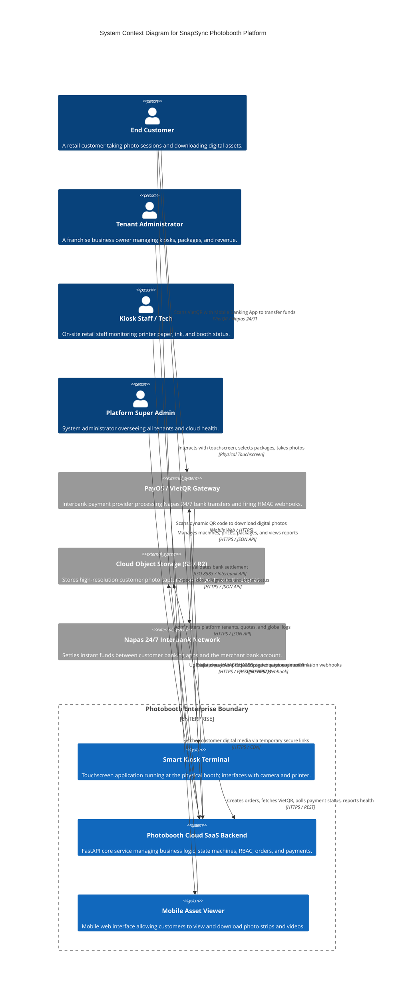

# Project Proposal & Plan: Cloud-Native Multi-Tenant Photobooth SaaS & Smart Kiosk Platform

**Document Version:** 1.0.0  
**Status:** Approved for Baseline  
**Project Track:** Commercial SaaS & Smart Kiosk Infrastructure Engineering  
**Target Platform:** Multi-Tenant Cloud Backend, Web Kiosk Touch Interface, and Mobile Asset Viewer  

---

## Table of Contents

- [2. Vision](#2-vision)
  - [2.1 Preliminary Problem Statement](#21-preliminary-problem-statement)
  - [2.2 Product Position Statement](#22-product-position-statement)
  - [2.3 Stakeholders and Users](#23-stakeholders-and-users)
  - [2.4 Scope and Key Features](#24-scope-and-key-features)
- [3. Proposed Solution](#3-proposed-solution)
  - [3.1 Preliminary Architecture (C4 Context Model)](#31-preliminary-architecture-c4-context-model)
  - [3.2 Technology Stack](#32-technology-stack)
  - [3.3 Hardware and Operating Environment](#33-hardware-and-operating-environment)
- [4. Project Plan](#4-project-plan)
  - [4.1 Development Methodology](#41-development-methodology)
  - [4.2 Work Breakdown Structure (WBS) & Milestones](#42-work-breakdown-structure-wbs--milestones)
  - [4.3 Resource Allocation & Team Roles](#43-resource-allocation--team-roles)
  - [4.4 Schedule and Timeline (Gantt Representation)](#44-schedule-and-timeline-gantt-representation)
- [5. Risk Management](#5-risk-management)
  - [5.1 Risk Identification & Categorization](#51-risk-identification--categorization)
  - [5.2 Risk Assessment Matrix](#52-risk-assessment-matrix)
  - [5.3 Mitigation and Contingency Strategies](#53-mitigation-and-contingency-strategies)

---

# 2. Vision

## 2.1 Preliminary Problem Statement

### 2.1.1 Business Context and Background
Over the past five years, the social entertainment and retail experience market in Vietnam and Southeast Asia has experienced a massive cultural resurgence in self-operated photo booths (often popularized as "Korean-style 4-cut photobooths" or life-four-cut studios). Deployed across shopping malls, cinemas, pedestrian walking streets, and university campuses, these kiosks attract high volumes of Gen Z and young millennial consumers seeking instant physical photo prints and digital mementos to share on Instagram and TikTok.

Historically, photobooth kiosks were standalone, coin- or bill-operated electro-mechanical units running monolithic offline software. As consumer payment habits in Vietnam have radically transformed toward instant cashless bank transfers (Napas 24/7 and dynamic VietQR codes via payment facilitators such as PayOS), legacy photobooth operations have become severely bottlenecked by manual maintenance, high cash handling overhead, security vulnerabilities, and a complete lack of centralized operational visibility.

### 2.1.2 Problem Analysis and Core Challenges
Operating a fleet of modern, unattended photobooth kiosks presents four critical business and technological challenges:

1. **Payment Friction and Unattended Reliability:**
   - Physical cash acceptors frequently jam, require routine manual collection by on-site staff, and are susceptible to theft or vandalism.
   - Traditional Point-of-Sale (POS) card swipe/chip terminals require expensive merchant hardware, incur recurring terminal rental fees, and suffer from high transaction fees.
   - While VietQR bank transfers represent over 80% of retail transactions in Vietnam, unattended kiosks face unique edge cases: delayed bank webhooks, intermittent network dropouts, customers scanning an expired QR code, or duplicate webhook delivery leading to double-crediting or race conditions. Without an automated, transactional state machine, kiosks fail to trigger photo capture sessions reliably, causing customer frustration and operational refund overhead.

2. **Lack of Centralized Multi-Tenant Fleet Management:**
   - Operators and franchise brands manage booths distributed across multiple geographic cities and shopping centers. Currently, pricing adjustments, photo package updates, promotional frames, and revenue tracking must be manually uploaded or extracted on-site via USB drives or remote desktop sessions.
   - Business owners lack real-time telemetry into machine health (e.g., printer paper/ribbon exhaustion, camera disconnects, system offline status), resulting in prolonged machine downtime and lost revenue.

3. **Digital Asset Delivery and User Privacy:**
   - Modern consumers demand both high-gloss physical printouts and instant, high-resolution digital copies (including behind-the-scenes timelapse videos) accessible on their mobile devices.
   - Existing solutions often force customers to type their phone numbers or email addresses on public touchscreens—introducing friction, queue congestion, and severe privacy and data leak risks. A contactless, privacy-preserving digital handoff mechanism is urgently required.

4. **Multi-Tenancy and Data Isolation:**
   - Scaling a photobooth platform as a Software-as-a-Service (SaaS) requires supporting multiple independent franchise operators (tenants) on a shared cloud infrastructure. Each tenant must strictly control their own kiosk fleet, pricing packages, customer transaction history, and staff permissions under strict Role-Based Access Control (RBAC), ensuring zero cross-tenant data leakage.

### 2.1.3 Operating Environment
The platform operates in a hybrid distributed environment composed of edge kiosks, cloud infrastructure, and mobile client interfaces:
- **Cloud Infrastructure:** Linux-based cloud virtual machines or managed container clusters (AWS / GCP / DigitalOcean) running asynchronous containerized backend services, an ACID-compliant transactional relational database, and an S3-compatible distributed object storage layer.
- **Edge Kiosk Terminal:** Unattended touch-screen kiosks running modern Chromium-based embedded browsers or Electron shells connected to local peripherals (DSLR camera via gPhoto2/SDK, commercial dye-sublimation photo printers via CUPS/Windows spooler).
- **Customer Mobile Environment:** Standard mobile web browsers (Safari on iOS, Chrome on Android) rendering responsive web pages loaded via dynamic QR codes to preview and download digital media without requiring native app installations.

### 2.1.4 Design and Implementation Constraints
- **Language & Runtime:** Python 3.12+ utilizing strict typing, structured concurrency, and async/await non-blocking I/O primitives.
- **Framework & Asynchronous Execution:** FastAPI (ASGI via Uvicorn), ensuring sub-50ms endpoint latencies under high concurrent webhook loads.
- **Database Architecture:** PostgreSQL 16+ accessed through async SQLAlchemy 2.0 and `asyncpg` drivers. The system must enforce database-level transactional integrity, pessimistic row-level locking (`SELECT ... FOR UPDATE`), and unique transaction constraints to eliminate double-fulfillment race conditions.
- **Security & Authorization:** Cryptographically signed JSON Web Tokens (PyJWT) with RBAC (`SUPER_ADMIN`, `TENANT_ADMIN`, `STAFF`, `MACHINE_SERVICE`). All inbound payment webhooks must be cryptographically verified using HMAC-SHA256 signatures against gateway checksum secrets before request processing.
- **Engineering Standards:** Strict OpenAPI 3.0 auto-generation, 100% Pydantic v2 data validation schemas, automated linting via Ruff, and deterministic environment synchronization via `uv`.

---

## 2.2 Product Position Statement

| Element | Content |
| :--- | :--- |
| **For** | Photobooth franchise operators, entertainment venue owners, and retail brand managers in Southeast Asia. |
| **Who** | Require an unattended, reliable, and automated kiosk operation with instant cashless payments, centralized multi-tenant management, and frictionless digital asset distribution. |
| **The *SnapSync* Platform** | A cloud-native, multi-tenant Photobooth Management SaaS and Smart Kiosk Backend. |
| **That** | Delivers real-time VietQR/Napas 24/7 bank transfer integration, race-condition immune payment webhooks, live kiosk telemetry, dynamic photo package catalog management, and seamless contactless mobile photo retrieval. |
| **Unlike** | Legacy offline photobooth software, cash-dependent booth controllers, and ad-hoc single-machine installations that suffer from frequent downtime and lack centralized visibility. |
| **Our product** | Provides a turnkey, enterprise-grade multi-tenant architecture with cryptographic payment audit trails, asynchronous concurrency guarantees, multi-role access control, and automated fleet monitoring. |

---

## 2.3 Stakeholders and Users

| # | Stakeholder / User | Description | Main Interests |
| :--- | :--- | :--- | :--- |
| 1 | **Project Sponsor & Investors** | Executive leadership and financial backers funding platform development and deployment. | Time-to-market, return on investment (ROI), platform scalability, system security, and market defensibility. |
| 2 | **Tenant Admin (Franchise Owner)** | Business owners who purchase or lease photobooth hardware and manage kiosk locations. | Real-time revenue analytics, remote package pricing and layout configuration, uptime monitoring, and multi-kiosk oversight. |
| 3 | **Store Staff / Field Technician** | On-site retail staff or technical maintenance personnel responsible for kiosk upkeep. | Fast paper/ink reload alerts, device diagnostic status (camera/printer online status), and simplified order refund/review workflows. |
| 4 | **End Consumer (Kiosk Customer)** | Walk-up retail users taking photo sessions with friends or family at kiosks. | Fast and intuitive UX, frictionless VietQR scanning, instant booth unlock, high-quality prints, and immediate private photo downloads. |
| 5 | **Platform Super Administrator** | Internal engineering and operations team hosting the SaaS infrastructure. | Global system health, tenant isolation, cross-tenant auditing, API security, database performance, and compliance management. |
| 6 | **Payment Gateway Partner (PayOS / Napas)** | External financial infrastructure partner providing payment processing and webhook routing. | Strict webhook response handling (HTTP 200 within 3 seconds), idempotent event processing, and accurate HMAC verification. |

---

## 2.4 Scope and Key Features

The platform scope is prioritized using the **MoSCoW** framework. Only **Must-have** features are strictly required for the foundational MVP (Release 1.0 baseline), while Should-have and Could-have items establish the subsequent release roadmap.

| ID | Feature | Description | Priority (M/S/C/W) |
| :--- | :--- | :--- | :--- |
| **F01** | Multi-Tenant Data Isolation & Hierarchy | Separation of data across independent tenants, kiosk machines, photo packages, and user accounts. | **Must** |
| **F02** | Role-Based Access Control (RBAC) & JWT Auth | Secure authentication granting specific API permissions across Super Admin, Tenant Admin, Staff, and Machine Service accounts. | **Must** |
| **F03** | Order & Session State Machine | Formal state machine managing order lifecycles (`PENDING` → `PAID` / `CANCELLED` / `EXPIRED` / `FLAGGED_FOR_REVIEW`). | **Must** |
| **F04** | Dynamic VietQR / PayOS Payment Generation | Automatic creation of dynamic EMVCo-compliant QR codes linked to orders with precise transfer amounts and descriptions. | **Must** |
| **F05** | Idempotent HMAC Webhook Receiver | Cryptographic HMAC-SHA256 signature verification, row-level locking, and duplicate replay attack rejection. | **Must** |
| **F06** | Machine Fleet Management & Polling | CRUD APIs for kiosk registration, location tagging, active package queries, and payment status polling. | **Must** |
| **F07** | Digital Asset Upload & Pre-signed Delivery | Asynchronous photo and video upload pipeline to S3 storage with temporary signed download URLs. | **Should** |
| **F08** | Real-time Kiosk Hardware Telemetry | Status reporting for printer paper levels, ink status, camera connection, and network heartbeat. | **Should** |
| **F09** | Tenant Revenue & Order Analytics Dashboard | Aggregated business reporting showing revenue by date range, top-selling packages, and average session times. | **Should** |
| **F10** | Contactless Customer QR Media Download | Ephemeral web viewer allowing customers to scan an on-screen QR code to download photo strips and animated GIFs. | **Should** |
| **F11** | Dynamic Frame & Overlay Template Engine | Remote distribution of seasonal and branded photo overlay frames to specific kiosk machines. | **Could** |
| **F12** | WebSocket Live Payment Notification | Push-based socket connection to kiosk terminals eliminating the need for client HTTP polling. | **Could** |
| **F13** | Multi-language Kiosk Interface | Internationalization support (Vietnamese, English, Korean, Japanese) on kiosk touchscreens. | **Could** |
| **F14** | Offline Cash Acceptor Hardware Integration | Physical bill/coin acceptor hardware drivers and physical cash audit loggers. | **Won't** |
| **F15** | Direct Credit Card EMV Chip/PIN Terminal SDK | Direct integration with proprietary bank POS hardware terminals. | **Won't** |
| **F16** | AI Face Retouching / Generative Avatars | Server-side generative AI filters or facial transformation pipelines. | **Won't** |

### Out of Scope:
- **Physical Cash Handling:** The system exclusively targets digital cashless transactions (VietQR / Napas / PayOS); physical bill validators, coin counters, and coin hoppers are excluded.
- **Proprietary POS Terminal Hardware:** External physical bank card swipe/chip terminals requiring proprietary merchant payment firmware are not implemented.
- **Custom Hardware Manufacturing:** Physical kiosk chassis fabrication, internal wiring schematics, and coin-box locks are outside the software scope.
- **Heavy On-Device Video Rendering:** Complex 3D generative AI effects or server-side video rendering farms are deferred to future commercial expansions.

---

# 3. Proposed Solution

## 3.1 Preliminary Architecture (C4 Context Model)

The following C4 System Context diagram illustrates the boundaries of the Photobooth SaaS Platform, its user personas, and its interactions with external supporting systems:



### Architectural Communication Flows:
1. **Order Initiation:** The Kiosk Terminal requests an order via `POST /api/v1/orders`. The backend validates the machine authentication token and persists an order in `PENDING` status.
2. **Payment Creation:** The kiosk requests payment initiation via `POST /api/v1/orders/{id}/payments`. The backend contacts PayOS to generate a dynamic VietQR payload and checkout link, storing a `Payment` record.
3. **Customer Transfer:** The customer scans the displayed VietQR code using any Vietnamese banking app (Vietcombank, Techcombank, MB Bank, MoMo, etc.) and transfers the exact amount.
4. **Webhook Ingestion & Idempotency:** PayOS posts an HMAC-SHA256 signed payload to `POST /api/v1/webhooks/payos`. The backend executes a pessimistic lock (`SELECT ... FOR UPDATE`) on the target order, verifies the signature, enforces idempotency against duplicate transaction references, transitions the order state to `PAID`, and logs an immutable `PaymentEvent`.
5. **Session Trigger:** The kiosk detects the `PAID` state via polling or WebSocket, unlocks the session, guides the user through capture, prints the photos, uploads assets to S3, and renders the customer download QR code.

---

## 3.2 Technology Stack

| Layer | Technology | Reason for Choice |
| :--- | :--- | :--- |
| **Backend API Framework** | **FastAPI 0.111+ (Python 3.12)** | Asynchronous ASGI architecture capable of handling thousands of concurrent non-blocking I/O requests with native Pydantic v2 validation, automatic OpenAPI documentation, and minimal runtime overhead. |
| **Asynchronous Database Driver** | **Asyncpg + SQLAlchemy 2.0 (Asyncio)** | Highest performance PostgreSQL driver for Python. SQLAlchemy 2.0 provides fully typed declarative models, unified async session management, and explicit transactional boundaries. |
| **Database System** | **PostgreSQL 16+** | Battle-tested relational database offering strict ACID guarantees, robust row-level locking primitives (`FOR UPDATE NOWAIT`), native JSONB support, and partial index capabilities. |
| **Kiosk Front-end Application** | **React / TypeScript + Vite (packaged in Electron / Kiosk Chrome)** | Component-based, responsive touch UI with strict type safety, fast state management, and direct integration with local hardware bridges (USB camera/printer). |
| **Admin Web Portal** | **React / Next.js / Tailwind CSS** | Clean, modular component library enabling rapid creation of responsive tenant management dashboards, charts, and table pagination. |
| **Object Storage** | **Cloudflare R2 / AWS S3** | S3-compatible cloud storage offering zero-egress fees (Cloudflare R2), high availability, and pre-signed URL capabilities for direct, secure client uploads and downloads. |
| **Authentication & Cryptography** | **PyJWT + Passlib (Bcrypt) + HMAC-SHA256** | Standardized stateless JWT Bearer token authentication with role claims. Industry-standard HMAC-SHA256 hashing for webhook integrity verification. |
| **Dependency & Tooling** | **uv (Astral)** | High-speed Rust-based Python package manager and environment resolver, ensuring deterministic lockfiles (`uv.lock`) and lightning-fast CI build times. |
| **Containerization & Hosting** | **Docker, Docker Compose, Linux (Ubuntu 24.04 LTS)** | Hermetic runtime environments across development, staging, and production; seamless container orchestration on cloud VPS instances. |
| **Testing & Quality Assurance** | **Pytest + Pytest-Asyncio + HTTPX + Ruff** | Asynchronous integration and concurrency test suites simulating simultaneous webhook race conditions; lightning-fast linting and code formatting via Ruff. |

---

## 3.3 Hardware and Operating Environment

### 3.3.1 Kiosk Physical Hardware Specification
- **Computing Unit:** Industrial Mini PC / Intel NUC (Intel Core i5 11th Gen+, 16GB DDR4 RAM, 256GB NVMe SSD, Gigabit Ethernet, 4x USB 3.0 ports).
- **Display & Touch Surface:** 21.5-inch to 27-inch Full HD (1920×1080) Industrial Capacitive 10-point Multi-Touch Screen with anti-glare tempered glass.
- **Capture Equipment:** Canon EOS DSLR (e.g., EOS 1500D / 200D II) or 4K Ultra HD Wide-Angle Industrial Webcam connected via continuous AC dummy battery and USB tethering.
- **Photo Printer:** Commercial Dye-Sublimation Thermal Photo Printer (DNP DS-RX1HS / Citizen CY-02) delivering 300×300 DPI high-speed prints in under 13 seconds per 4×6-inch sheet.
- **Lighting & Peripherals:** External continuous LED studio ring light / softbox diffuser, integrated power supply distribution unit, cooling fans, and physical security enclosure locks.

### 3.3.2 Software Operating Environments
- **Development Environment:**
  - OS: macOS Sonoma / Windows 11 / Ubuntu 22.04 LTS.
  - Python 3.12 managed via `uv`.
  - Local PostgreSQL 16 instance containerized via `docker-compose.yml`.
  - Mock Payment Provider (`FakePayOSProvider`) simulating asynchronous bank webhooks and network latencies.
- **Testing & Staging Environment:**
  - Automated CI runners executing on Linux x86_64 runners.
  - Concurrency test harness firing simultaneous HTTP requests using `asyncio.gather()` to validate row-level locks and transaction boundaries.
  - PayOS Sandbox environment testing live Napas test bank transfers.
- **Production Environment:**
  - Cloud Virtual Machine / Managed Kubernetes cluster running behind NGINX reverse proxy with automated Let’s Encrypt TLS/SSL termination.
  - Managed PostgreSQL 16 instance configured with daily automated WAL backups and connection pooling.
  - Kiosk edge machines running locked-down Ubuntu Desktop or Windows 10/11 Enterprise LTSC in Dedicated Kiosk Mode with auto-restart on boot.

---

# 4. Project Plan

## 4.1 Development Methodology

The project follows an **Agile / Scrum** iterative software development methodology structured into two-week sprints. The iterative cycle guarantees that working, testable increments are delivered at the conclusion of each engineering phase:
- **Daily Standups:** 15-minute sync on completed tasks, immediate blockers, and daily deliverables.
- **Sprint Planning & Backlog Refinement:** Estimating story points using Planning Poker and assigning clear acceptance criteria.
- **Sprint Review & Demo:** Verifying functional endpoints and UI flows against live automated tests and cURL test scripts.
- **Continuous Integration (CI):** Every pull request requires passing Ruff linting checks, type verification, and end-to-end asynchronous test suites before merging into the main branch.

---

## 4.2 Work Breakdown Structure (WBS) & Milestones

The work breakdown is organized across five logical engineering phases delivering vertical slices of system capability:

```text
Photobooth SaaS Platform
├── 1.0 Phase 1: Inception, Requirements & Architectural Blueprinting
│   ├── 1.1 Problem Definition & Stakeholder Discovery
│   ├── 1.2 System Scope & MoSCoW Prioritization
│   ├── 1.3 High-Level C4 Architectural Modeling
│   └── 1.4 Risk Management & Feasibility Analysis
├── 2.0 Phase 2: Core Platform, Multi-Tenancy & Access Control
│   ├── 2.1 Multi-Tenant Relational Schema (PostgreSQL 16 / Alembic)
│   ├── 2.2 Async Session & Database Connection Pooling (SQLAlchemy 2.0)
│   ├── 2.3 Cryptographic Authentication & RBAC Authorization (JWT)
│   └── 2.4 Machine Fleet Management & Tenant-Aware Cursor Pagination
├── 3.0 Phase 3: Transaction State Machine & Payment Gateway Integration
│   ├── 3.1 VietQR Dynamic Generation & PayOS Payment Request Handlers
│   ├── 3.2 Order State Machine (PENDING -> PAID / EXPIRED / FLAGGED)
│   ├── 3.3 HMAC-SHA256 Cryptographic Webhook Receiver
│   └── 3.4 Concurrency Controls & Row-Level Locking (Pessimistic DB Locks)
├── 4.0 Phase 4: Kiosk Application, Peripheral Drivers & Asset Pipeline
│   ├── 4.1 Touchscreen Kiosk Interface (React / Electron Touch UI)
│   ├── 4.2 Local Hardware Bridges (DSLR Camera Tethering & Dye-Sub Printer Spooler)
│   ├── 4.3 S3-Compatible Cloud Media Ingestion & Pre-signed URL Generation
│   └── 4.4 Contactless Mobile Customer Photo Retrieval Portal
└── 5.0 Phase 5: Hardening, Concurrency Stress-Testing & Cloud Deployment
    ├── 5.1 Automated Concurrency Challenge Test Harness (asyncio.gather)
    ├── 5.2 Replay-Attack Simulation & Duplicate Webhook Elimination
    ├── 5.3 Docker Production Containerization & NGINX Reverse Proxy Setup
    └── 5.4 Production Telemetry, Health Checks & Operational Playbooks
```

---

## 4.3 Resource Allocation & Team Roles

| Role | Primary Responsibilities | Assigned Focus Areas |
| :--- | :--- | :--- |
| **Project Lead & Scrum Master** | Project scheduling, milestone tracking, stakeholder communication, and Agile ceremonies. | WBS oversight, risk mitigation, and milestone documentation. |
| **Backend & Security Engineer** | FastAPI core architecture, SQLAlchemy async models, JWT/RBAC security, and PayOS webhook state machines. | High-throughput backend APIs, database ACID locking, and cryptographic HMAC validation. |
| **Frontend & Kiosk Engineer** | Kiosk touchscreen application, customer download portal, and kiosk hardware bridging (printer/camera). | React/Electron kiosk interface, touchscreen UX, and hardware integration. |
| **Database & DevOps Specialist** | PostgreSQL database optimization, Alembic migrations, Docker containerization, and CI/CD pipelines. | DB schema design, index tuning, Docker Compose setup, and cloud deployment. |
| **QA & Test Automation Engineer** | Test plan formulation, automated integration testing, concurrency challenge execution, and manual verification. | Pytest-asyncio test suites, boundary condition testing, and regression suites. |

---

## 4.4 Schedule and Timeline (Gantt Representation)

```text
Week Number : W01 | W02 | W03 | W04 | W05 | W06 | W07 | W08 | W09 | W10 | W11 | W12
-------------------------------------------------------------------------------------
Phase 1 : [==== Phase 1: Inception & Architecture ====]
Phase 2 :                 [==== Phase 2: Core Platform & RBAC ====]
Phase 3 :                             [==== Phase 3: Payment Engine ====]
Phase 4 :                                         [==== Phase 4: Kiosk & Assets ====]
Phase 5 :                                                     [==== Phase 5: Hardening & Go-Live ====]
Milestone :                                                                         [★ Release 1.0]
```

### Engineering Milestones Summary:
- **Milestone 1 (Weeks 1–3) — Architecture & Foundations Baseline:** System Requirements, Domain Entity Model, C4 Architecture Blueprint, Technology Stack setup, and CI/CD pipelines.
- **Milestone 2 (Weeks 3–5) — Multi-Tenant Core Platform:** Async PostgreSQL layer, Tenant & Kiosk schema, JWT authentication, RBAC authorization, and Machine Fleet CRUD APIs.
- **Milestone 3 (Weeks 5–7) — Payment & Transaction Engine:** VietQR dynamic generation, HMAC-SHA256 signature verification, Order State Machine, and pessimistic row locking for race-condition prevention.
- **Milestone 4 (Weeks 7–9) — Kiosk Client & Digital Asset Distribution:** Touchscreen UI, camera tethering daemon, printer spooler integration, S3 object storage upload, and mobile QR download portal.
- **Milestone 5 (Weeks 9–12) — System Hardening & Production Release:** Automated concurrency stress-testing (`asyncio.gather`), replay-attack validation, staging dry-runs, containerized cloud deployment, and system telemetry monitoring.

---

# 5. Risk Management

## 5.1 Risk Identification & Categorization

Projects combining cloud multi-tenancy, real-time banking webhooks, and physical kiosk hardware exhibit multidimensional risk profiles. Risks are categorized into four core domains:

1. **Technical & Concurrency Risks (TR):** Network packet drops, out-of-order webhook delivery, double-spending, and database deadlocks.
2. **Hardware & Operational Risks (HR):** Physical paper jams, ribbon depletion, camera driver crashes, and loss of internet connectivity at kiosk sites.
3. **Security & Compliance Risks (SR):** HMAC secret compromise, cross-tenant data leakage, spoofed webhooks, and customer photo privacy violations.
4. **Schedule & Resource Risks (PR):** Scope creep, hardware delivery delays, and banking sandbox API version changes.

---

## 5.2 Risk Assessment Matrix

Risks are assessed based on **Likelihood (L: 1–5)** and **Impact (I: 1–5)**. The resulting **Risk Score (R = L × I)** classifies the severity:
- **Low (1–6):** Acceptable; standard operational monitoring.
- **Medium (8–12):** Moderate; proactive mitigation procedures required.
- **High (15–25):** Critical; active avoidance, architectural safeguards, and contingency plans mandatory.

| ID | Category | Risk Description | Likelihood (1–5) | Impact (1–5) | Score (1–25) | Severity |
| :--- | :--- | :--- | :---: | :---: | :---: | :--- |
| **R01** | Technical | **Concurrent Webhook Race Conditions:** Gateway fires identical webhooks simultaneously, triggering double-fulfillment or duplicate prints. | 4 | 5 | **20** | **High** |
| **R02** | Technical | **Network Dropout During Bank Transfer:** Kiosk loses internet connectivity while the customer transfers money via mobile banking. | 3 | 4 | **12** | **Medium** |
| **R03** | Operational | **Printer Paper / Dye Ribbon Exhaustion:** Kiosk accepts payment when the printer is out of paper, failing to print photo strips. | 4 | 4 | **16** | **High** |
| **R04** | Security | **Webhook Spoofing / Tampering:** Malicious third parties post fake payment success events to unlock booths without transferring money. | 3 | 5 | **15** | **High** |
| **R05** | Security | **Cross-Tenant Data Exposure:** Flawed database queries allow Tenant A to access Tenant B's revenue, packages, or photos. | 2 | 5 | **10** | **Medium** |
| **R06** | Operational | **DSLR Camera Disconnect / Freeze:** Camera hangs via USB tether or enters sleep mode during a customer session. | 3 | 4 | **12** | **Medium** |
| **R07** | Technical | **Late Payment on Expired Order:** Customer scans a QR code after the 15-minute order window has expired. | 4 | 3 | **12** | **Medium** |
| **R08** | Schedule | **External Payment Gateway Outage / API Changes:** Downtime or breaking payload changes from PayOS / Napas banking infrastructure. | 2 | 4 | **8** | **Medium** |

---

## 5.3 Mitigation and Contingency Strategies

| Risk ID | Risk Description | Proactive Prevention Strategy | Reactive Contingency Plan |
| :--- | :--- | :--- | :--- |
| **R01** | **Concurrent Webhook Race Conditions** | Dual-layer idempotency: PostgreSQL unique constraint on transaction reference (`uq_payment_events_transaction_ref`) combined with pessimistic row-level locking (`SELECT ... FOR UPDATE`). | Duplicate webhook catches unique constraint violation; handler gracefully ignores reprocessing and immediately returns HTTP 200 OK with status `DUPLICATE`. State machine remains unchanged. |
| **R02** | **Network Dropout During Bank Transfer** | Kiosk-side local SQLite event buffer; exponential backoff polling mechanism with a retry budget; backend durable queueing. | Once internet connectivity recovers, kiosk queries `GET /api/v1/orders/{id}/payment-status` and seamlessly resumes the session without requiring customer repayment. |
| **R03** | **Printer Paper / Dye Ribbon Exhaustion** | Continuous hardware telemetry polling; backend queries printer spooler status and blocks order creation if consumables drop below threshold. | Kiosk touch screen disables the "Start Session" button, displays an "Out of Paper / Under Maintenance" banner, and dispatches an alert to on-site technicians. |
| **R04** | **Webhook Spoofing / Tampering** | Raw byte-level HMAC-SHA256 signature verification computed against the shared `PAYOS_CHECKSUM_KEY` prior to payload parsing. | Webhook rejected with HTTP 400 Bad Request; security incident logged with client IP address; rate-limiter temporarily blocks offending source IP. |
| **R05** | **Cross-Tenant Data Exposure** | Architectural tenant isolation: all database queries strictly filter by `tenant_id`; RBAC authorization dependency (`require_role`) enforced across all API endpoints. | Automated security token revocation; PostgreSQL query access audit; immediate credential rollover and security review. |
| **R06** | **DSLR Camera Disconnect / Freeze** | Periodic keep-alive heartbeat to the camera daemon every 10 seconds; OS-level USB auto-suspend disabled; AC continuous dummy battery power. | Automated supervisor daemon restarts the USB camera driver; kiosk switches to a secondary high-definition industrial webcam if DSLR fails to reconnect. |
| **R07** | **Late Payment on Expired Order** | Order State Machine records state as `LATE_PAYMENT`; immutable `PaymentEvent` recorded with non-reconciled status; booth session remains locked. | Customer receives an SMS/QR digital voucher code, or store staff issues a one-click refund or booth credit via the management portal. |
| **R08** | **Payment Gateway Outage / API Changes** | Abstract `PaymentProvider` interface in backend architecture (Factory Pattern); decoupling business logic from third-party vendor SDKs. | Hot-swap gateway configuration to a fallback payment provider (e.g., MoMo QR, VNPay, or ZaloPay) with zero core business logic changes. |
