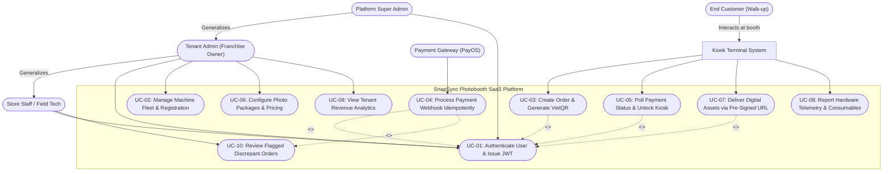

# Software Requirements Specification (SRS)
## Project: SnapSync — Cloud-Native Multi-Tenant Photobooth SaaS & Smart Kiosk Platform

**Document Version:** 1.0.0  
**Status:** Approved for Baseline  
**Course / Track:** Software Engineering Practice Assignment (PA2 — Requirements Specification)  
**Target Platform:** Multi-Tenant Cloud Backend (FastAPI / PostgreSQL), Smart Kiosk Terminal (Electron / Touchscreen), and Mobile Asset Viewer  

---

## Table of Contents
- [1. Problem Statement](#1-problem-statement)
  - [1.1 Business Context & Market Background](#11-business-context--market-background)
  - [1.2 Problem Analysis & Core Challenges](#12-problem-analysis--core-challenges)
  - [1.3 System Objectives & Solution Boundary](#13-system-objectives--solution-boundary)
- [4. Stakeholders](#4-stakeholders)
- [5. Requirements](#5-requirements)
  - [5.1 Functional Requirements](#51-functional-requirements)
  - [5.2 Non-Functional Requirements](#52-non-functional-requirements)
  - [5.3 Domain Requirements and Business Rules](#53-domain-requirements-and-business-rules)
  - [5.4 Acceptance Criteria](#54-acceptance-criteria)
- [6. Use Case Model](#6-use-case-model)
  - [6.1 Use Case Diagram](#61-use-case-diagram)
  - [6.2 Actors](#62-actors)
  - [6.3 Use Case List](#63-use-case-list)
- [7. Use Case Specifications](#7-use-case-specifications)
  - [7.1 Use Case UC-01: Authenticate User & Issue JWT](#71-use-case-uc-01-authenticate-user--issue-jwt)
  - [7.2 Use Case UC-02: Manage Machine Fleet & Registration](#72-use-case-uc-02-manage-machine-fleet--registration)
  - [7.3 Use Case UC-03: Create Photobooth Order & Generate VietQR](#73-use-case-uc-03-create-photobooth-order--generate-vietqr)
  - [7.4 Use Case UC-04: Process Payment Webhook Idempotently](#74-use-case-uc-04-process-payment-webhook-idempotently)
  - [7.5 Use Case UC-05: Poll Payment Status & Unlock Kiosk Session](#75-use-case-uc-05-poll-payment-status--unlock-kiosk-session)
  - [7.6 Use Case UC-06: Configure Photo Packages & Pricing](#76-use-case-uc-06-configure-photo-packages--pricing)
  - [7.7 Use Case UC-07: Deliver Digital Assets via Pre-Signed URL](#77-use-case-uc-07-deliver-digital-assets-via-pre-signed-url)

---

# 1. Problem Statement

### 1.1 Business Context & Market Background
Over the past five years, the retail entertainment and experiential social market in Vietnam and Southeast Asia has experienced a major boom in self-service photo studios (popularly known as Korean-style 4-cut photobooths / *Life Four Cuts*). Located in high-footfall commercial zones—such as shopping malls (Vincom, Aeon Mall), cinema lobbies, pedestrian walking streets, and university recreation centers—these automated kiosks attract high volumes of Gen-Z and young millennial consumers who desire instant, studio-grade physical photo strips along with digital media (still photos and animated GIF/timelapse videos) for social sharing on Instagram and TikTok.

Concurrently, consumer payment habits in Vietnam have undergone a radical transformation toward instant cashless bank transfers powered by the **Napas 24/7** interbank clearing network and standardized **VietQR** (EMVCo-compliant) dynamic QR codes processed via payment facilitators such as PayOS.

### 1.2 Problem Analysis & Core Challenges
Operating an unattended, distributed fleet of commercial photobooths presents four fundamental business, financial, and architectural challenges:

1. **Payment Friction and Unattended Hardware Reliability:**
   - Physical cash and banknote acceptors frequently jam, require routine manual collection by on-site staff, and represent high physical theft and vandalism risks.
   - Traditional Point-of-Sale (POS) card swipe/chip terminals require expensive proprietary merchant hardware, incur recurring terminal rental fees, and charge non-negligible transaction commissions.
   - While VietQR bank transfers represent over 80% of retail transactions, unattended kiosks face unique edge cases: delayed bank webhooks, intermittent kiosk network connections, duplicate webhook delivery, and race conditions leading to double-crediting or sessions failing to trigger despite successful customer bank deduction. Without an automated, transactional state machine, kiosks fail to trigger photo capture sessions reliably, causing customer frustration and refund overhead.

2. **Fragmented, Non-Centralized Multi-Tenant Fleet Management:**
   - Franchise operators manage dozens of kiosks distributed across multiple shopping centers and geographic cities. Historically, pricing adjustments, photo package updates, promotional frames, and revenue tracking required physical USB drive uploads or ad-hoc remote desktop sessions (AnyDesk/TeamViewer).
   - Business owners lack real-time telemetry into machine health (e.g., printer paper roll or dye-sub ribbon exhaustion, camera disconnects, system offline status), resulting in prolonged machine downtime and lost sales.

3. **Digital Asset Delivery and User Privacy Violations:**
   - Modern consumers demand both high-gloss physical printouts and instant, high-resolution digital copies (including behind-the-scenes timelapse recordings).
   - Existing solutions often force customers to type their phone numbers or email addresses on public touchscreens—introducing friction, queue congestion, hygiene concerns, and severe violations of personal data privacy regulations. A contactless, privacy-preserving digital handoff mechanism is urgently required.

4. **Multi-Tenancy and Data Isolation:**
   - Scaling a photobooth platform as a Software-as-a-Service (SaaS) requires supporting multiple independent franchise operators (tenants) on a shared cloud infrastructure. Each tenant must strictly control their own kiosk fleet, pricing packages, customer transaction history, and staff permissions under strict Role-Based Access Control (RBAC), ensuring zero cross-tenant data leakage.

### 1.3 System Objectives & Solution Boundary
**SnapSync** provides a cloud-native SaaS backend and smart edge kiosk integration that:
- Automates dynamic VietQR generation and processes payment gateway webhooks idempotently with row-level database locking (`SELECT ... FOR UPDATE`) in under 2 seconds.
- Guarantees strict multi-tenant isolation and hierarchical RBAC (`SUPER_ADMIN`, `TENANT_ADMIN`, `OPERATOR`, `CUSTOMER`).
- Centralizes remote machine fleet monitoring, package catalog management, and revenue analytics.
- Distributes digital media assets contactlessly via ephemeral pre-signed Cloud Object Storage (S3 / R2) URLs and mobile-scannable QR codes without capturing personal identifying information (PII).

*(Note: The system context boundary and external interfaces are modeled in the C4 Context diagram; the editable vector file is maintained at [`docs/diagrams/c4-context-model.excalidraw`](diagrams/c4-context-model.excalidraw).)*

---

# 4. Stakeholders

| # | Stakeholder | Description | Interests / concerns |
| :--- | :--- | :--- | :--- |
| **1** | **Project Sponsor & Investors** | Executive leadership and capital investors funding platform development and nationwide franchise expansion. | • Maximum system availability and Return on Investment (ROI).<br>• Scalable multi-tenant cloud cost structure.<br>• Data compliance and financial auditing integrity.<br>• Rapid time-to-market across shopping malls and retail centers. |
| **2** | **Tenant Administrator (Franchise Owner)** | Commercial franchisees who purchase or lease photobooth hardware and manage business operations within designated territories. | • Real-time sales analytics and automated revenue reconciliation.<br>• Remote management of photo packages, pricing, and promotional frames.<br>• Immediate alerts for machine downtime or low consumables.<br>• Zero risk of cross-tenant data exposure. |
| **3** | **Store Operator / Field Technician** | On-site retail staff and field maintenance technicians responsible for physical hardware operations. | • Real-time hardware health alerts (dye-sub printer paper/ribbon levels, camera status).<br>• Clear diagnostic dashboards for booth troubleshooting.<br>• Streamlined manual override and order refund/review workflows. |
| **4** | **End Consumer (Kiosk Customer)** | Walk-up retail users taking photo sessions with friends or family at unattended physical kiosks. | • Frictionless touch UI with zero payment delays.<br>• Accurate VietQR code generation and instant booth unlocking.<br>• High-quality physical prints and immediate, private access to digital photos and timelapse clips without having to enter personal phone numbers or emails. |
| **5** | **Platform Super Administrator** | SaaS system operations and DevOps engineering team hosting and maintaining cloud infrastructure. | • Global system health, API latency, and database connection pooling.<br>• Tenant provisioning, suspension, and subscription quota enforcement.<br>• Security auditing, HMAC key management, and zero unhandled concurrency errors. |
| **6** | **Payment Gateway Partner (PayOS / Napas)** | Interbank payment intermediary routing Napas 24/7 transfers and dispatching HTTP webhooks. | • Strict adherence to webhook response SLA (HTTP 200 returned within 3 seconds).<br>• Deterministic cryptographic HMAC-SHA256 signature verification.<br>• Replay-safe, idempotent webhook handling without duplicate fulfillment. |

---

# 5. Requirements

## 5.1 Functional Requirements

| ID | Requirement | Feature | Priority | Source |
| :--- | :--- | :--- | :--- | :--- |
| **FR-01** | The system shall isolate all database queries, domain entities, and operational logs by unique `tenant_id` to prevent cross-tenant data leakage. | F01: Multi-Tenant Data Isolation | **Must** | Architecture Spec / Sponsor |
| **FR-02** | The system shall enforce JSON Web Token (JWT) Bearer authentication and Role-Based Access Control (RBAC) across four roles: `SUPER_ADMIN`, `TENANT_ADMIN`, `OPERATOR`, and `CUSTOMER`. | F02: Authentication & RBAC | **Must** | Security Policy / Tenant Admin |
| **FR-03** | The system shall maintain an immutable, transactional state machine for photobooth orders supporting states: `PENDING`, `PAID`, `CANCELLED`, `EXPIRED`, and `FLAGGED_FOR_REVIEW`. | F03: Order State Machine | **Must** | Domain Model / Day 2 Guide |
| **FR-04** | The system shall automatically generate dynamic EMVCo-compliant VietQR codes and PayOS payment links upon kiosk order creation, encoding exact amount and unique transfer description. | F04: Dynamic VietQR Payment | **Must** | PayOS Spec / Customer Need |
| **FR-05** | The system shall cryptographically verify inbound webhook requests using HMAC-SHA256 against a pre-shared gateway secret and reject tampered payloads with HTTP 400. | F05: Idempotent Webhook Engine | **Must** | Payment Gateway / Security |
| **FR-06** | The system shall execute pessimistic row-level locking (`SELECT ... FOR UPDATE`) during payment webhook processing to guarantee that duplicate or concurrent webhooks result in exactly one successful payment transition. | F05: Idempotent Webhook Engine | **Must** | Concurrency Spec / Day 2 Guide |
| **FR-07** | The system shall provide RESTful CRUD APIs for registering, updating, activating, deactivating, and paginating physical photobooth kiosks. | F06: Machine Fleet Management | **Must** | Field Technician / Tenant Admin |
| **FR-08** | The system shall allow authorized Kiosk Terminals to continuously poll the payment status of an active order until it transitions to `PAID` or expires. | F06: Machine Fleet Management | **Must** | Kiosk Client Spec |
| **FR-09** | The system shall allow Tenant Administrators to create, edit, deactivate, and price photo packages (`price_vnd > 0`, `duration_seconds > 0`). | F06: Machine Fleet Management | **Must** | Tenant Admin |
| **FR-10** | The system shall flag an order as `FLAGGED_FOR_REVIEW` if a webhook reports an amount that does not match the designated order total (`webhook_amount != order_amount`). | F03: Order State Machine | **Must** | Accounting Audit / PayOS |
| **FR-11** | The system shall mark an order as `LATE_PAYMENT` if a valid payment webhook arrives after the order's `expires_at` timestamp. | F03: Order State Machine | **Must** | Business Rules / Day 2 Guide |
| **FR-12** | The system shall generate time-limited pre-signed upload URLs for S3/R2 storage allowing kiosks to securely upload processed photo strips and session videos. | F07: Digital Asset Pipeline | **Should** | Architecture Spec |
| **FR-13** | The system shall record and update kiosk telemetry heartbeats including printer paper level, ink ribbon status, and camera connection state every 60 seconds. | F08: Kiosk Hardware Telemetry | **Should** | Field Technician |
| **FR-14** | The system shall aggregate and display tenant revenue metrics, sales volume, top-selling packages, and average session times across customizable date ranges. | F09: Revenue Analytics | **Should** | Tenant Admin / Sponsor |
| **FR-15** | The system shall provide an ephemeral web portal accessible via dynamic QR code allowing customers to preview and download their digital photos and timelapse clips within 72 hours. | F10: Contactless Asset Delivery | **Should** | Customer Privacy / Marketing |
| **FR-16** | The system shall support dynamic distribution of seasonal and promotional frame overlay graphic templates to designated kiosk machines. | F11: Remote Frame Engine | **Could** | Tenant Admin |
| **FR-17** | The system shall push real-time order payment state updates directly to kiosk clients over persistent WebSocket connections to supersede HTTP polling. | F12: WebSocket Push Updates | **Could** | System Architect |
| **FR-18** | The system shall support multilingual kiosk touchscreen interfaces (Vietnamese, English, Korean, Japanese). | F13: Multilingual UI | **Could** | Franchise Brand Spec |

---

## 5.2 Non-Functional Requirements

| ID | Category | Requirement (Measurable) | How it will be verified |
| :--- | :--- | :--- | :--- |
| **NFR-01** | **Performance** | Under a baseline load of 200 concurrent HTTP requests, the API shall return responses with P95 latency ≤ 80 ms, and the payment webhook receiver endpoint shall respond within ≤ 150 ms at P99. | Automated load testing using `k6` or `Locust` simulating 200 concurrent virtual users hitting the orders, machines, and webhook endpoints. |
| **NFR-02** | **Concurrency & Idempotency** | When subjected to 2 identical concurrent webhooks executed via `asyncio.gather()`, the system shall guarantee exactly 1 successful state transition and 0 duplicate fulfillments (100% idempotency). | Concurrency integration test suite (`pytest -m asyncio`) executing concurrent HTTP requests with identical transaction reference IDs. |
| **NFR-03** | **Security** | All passwords must be hashed using bcrypt (cost factor ≥ 12); API authentication tokens must use HMAC-SHA256 signed JWTs with expiration ≤ 60 minutes; all incoming payment webhooks must match gateway HMAC signatures. | Automated security regression suite verifying signature tampering rejection and token expiry enforcement; periodic OWASP ZAP automated vulnerability scans. |
| **NFR-04** | **Availability & Reliability** | The backend cloud service shall maintain an uptime of ≥ 99.9% (excluding planned maintenance windows not exceeding 2 hours per month). | Cloud provider uptime monitoring (AWS CloudWatch / Uptime Kuma) recording synthetic health check ping (`GET /health`) every 30 seconds. |
| **NFR-05** | **Data Integrity** | Database operations modifying order status and payment ledger balances must execute under transactional ACID isolation using PostgreSQL pessimistic locks (`SELECT ... FOR UPDATE`). | Automated database rollback testing verifying zero orphan records or partial updates upon forced mid-transaction exceptions. |
| **NFR-06** | **Usability & Response** | Kiosks shall display newly generated VietQR payment codes within ≤ 1.5 seconds from user selection on screen. | Client-side performance timing instrumentation logging order creation to QR image rendering latency over 4G/fiber connections. |
| **NFR-07** | **Scalability** | The database schema and connection pool (`asyncpg` max size 20, max overflow 10) shall sustain up to 10,000 completed orders per day per tenant without connection starvation or deadlocks. | Stress-testing database transactions under synthetic batch inserts and concurrent analytical queries using pgbench. |

---

## 5.3 Domain Requirements and Business Rules

| ID | Rule | Source (Policy, Law, Standard) |
| :--- | :--- | :--- |
| **BR-01** | **Strict Positive Pricing & Duration:** Every photo package must have a price in Vietnamese Dong strictly greater than zero (`amount_vnd > 0`) and a capture duration greater than zero (`duration_seconds > 0`). Free/zero-value orders are prohibited in the commercial catalog. | Internal Financial Audit Policy & Database Integrity Constraint (`check_positive_order_amount`) |
| **BR-02** | **VietQR Standard Format:** Dynamic QR codes generated for bank transfers must strictly comply with the State Bank of Vietnam Napas 24/7 EMVCo QR specification, encoding the merchant BIN, virtual account, order code, and exact currency amount in VND. | SBV Circular 18/2016/TT-NHNN & Napas VietQR Implementation Standard |
| **BR-03** | **Webhook Cryptographic Integrity:** Any payment webhook lacking an `x-signature` header or failing HMAC-SHA256 verification against the tenant/gateway secret must be rejected with HTTP 400 Bad Request, without triggering order state transitions. | Payment Gateway Technical Integration Standard (PayOS API Security Spec) |
| **BR-04** | **Order Payment Expiry Window:** A photobooth order in `PENDING` status expires exactly 10 minutes (`600 seconds`) after creation. Any payment arriving after expiration must be categorized as `LATE_PAYMENT` and held for operator manual review. | Kiosk Operations Policy & Queue Management Rule |
| **BR-05** | **Customer Privacy & Ephemeral Storage:** Customer digital media (photos, videos) stored in cloud object storage must automatically expire and be permanently purged after 72 hours. Capture systems must never mandate customer phone numbers or national IDs. | Vietnam Decree 13/2023/ND-CP on Personal Data Protection (PDPD) |
| **BR-06** | **Machine Consumable Safety Lock:** If a kiosk reports that printer paper or ink ribbon capacity has reached 0 units, the kiosk status must automatically transition to `maintenance` / `out_of_paper`, and the backend shall disallow new order creation on that machine. | Equipment Safety & Consumer Protection Policy |

---

## 5.4 Acceptance Criteria

### **Feature F01: Multi-Tenant Data Isolation & Hierarchy**
```gherkin
Scenario: Tenant Admin cannot access data belonging to another tenant
  Given an authenticated user "admin_tenant_A" with role "TENANT_ADMIN" belonging to Tenant A
  And an existing photobooth machine "BOOTH-B01" belonging to Tenant B
  When "admin_tenant_A" sends a GET request to "/api/v1/machines/{BOOTH-B01_id}"
  Then the response status code must be 404 Not Found
  And no details or operational data of Tenant B shall be returned
```

### **Feature F02: Role-Based Access Control (RBAC) & JWT Auth**
```gherkin
Scenario: Operator attempts to perform restricted administrative action
  Given an authenticated user "bob_operator" with role "OPERATOR"
  When "bob_operator" sends a POST request to "/api/v1/packages" to create a new pricing package
  Then the response status code must be 403 Forbidden
  And the response body must contain an error message stating "Insufficient role permissions"
```

### **Feature F03: Order & Session State Machine**
```gherkin
Scenario: Order transitions successfully from PENDING to PAID upon valid payment
  Given an order with order_code "ORD-8821" in "PENDING" status with amount 70,000 VND
  When a valid payment event of 70,000 VND is processed for "ORD-8821"
  Then the order status must transition to "PAID"
  And the order "paid_at" timestamp must be recorded
  And subsequent duplicate payment attempts for "ORD-8821" must not alter its state
```

### **Feature F04: Dynamic VietQR / PayOS Payment Generation**
```gherkin
Scenario: Kiosk creates a new order and receives a dynamic VietQR payload
  Given an active kiosk machine "BOOTH-001" and an active package "Standard 4-Cut" costing 70,000 VND
  When the kiosk sends a POST request to "/api/v1/orders" specifying the package and machine ID
  Then the response status code must be 201 Created
  And the response payload must contain a valid unique "order_code"
  And the response payload must contain an EMVCo-compliant "qr_code" string and a checkout "payment_url"
  And the initial order status must be "PENDING"
```

### **Feature F05: Idempotent HMAC Webhook Receiver**
```gherkin
Scenario: Duplicate payment webhooks received concurrently
  Given an order "ORD-9901" in "PENDING" status
  And a valid payment webhook payload with transaction reference "TXN-VIETQR-001"
  When two identical webhook requests are posted to "/api/v1/webhooks/payos" simultaneously
  Then exactly one request must perform the order state transition to "PAID"
  And exactly one payment event must be recorded in the audit ledger
  And both webhook requests must receive HTTP 200 OK without unhandled 500 server errors
```

### **Feature F06: Machine Fleet Management & Payment Status Polling**
```gherkin
Scenario: Kiosk polls payment status during active customer checkout
  Given an order "ORD-7712" created by kiosk "BOOTH-001"
  When the kiosk sends a GET request to "/api/v1/orders/{ORD-7712_id}/payment-status"
  Then the response status code must be 200 OK
  And the response body must return the current status ("PENDING" or "PAID") and a boolean flag "is_unlocked"
```

---

# 6. Use Case Model

## 6.1 Use Case Diagram



---

## 6.2 Actors

| Actor | Description |
| :--- | :--- |
| **End Customer** | Walk-up retail customer at the physical kiosk selecting photo packages, scanning VietQR codes with banking apps, and retrieving printed/digital photos. |
| **Kiosk Terminal System** | Autonomous client application (Electron/Chromium on Industrial Mini PC) interfacing with camera, printer, and the SnapSync Cloud API. |
| **Store Staff / Field Tech** | On-site retail or maintenance personnel responsible for replenishing photo paper rolls, dye-sub ribbons, and inspecting machine status. |
| **Tenant Admin** | Franchise owner who manages kiosks, configures packages and pricing, reviews revenue dashboards, and resolves flagged order issues. |
| **Platform Super Admin** | SaaS system operator with unrestricted access across all tenants, machine fleets, system audit logs, and global settings. |
| **Payment Gateway (PayOS)** | External financial infrastructure service receiving Napas 24/7 bank transfers and notifying the backend via HMAC-signed HTTP webhooks. |

---

## 6.3 Use Case List

| ID | Use case | Primary actor | Priority | Related FR |
| :--- | :--- | :--- | :--- | :--- |
| **UC-01** | Authenticate User & Issue JWT | Store Staff / Tenant Admin / Super Admin | **Must** | FR-02 |
| **UC-02** | Manage Machine Fleet & Registration | Tenant Admin | **Must** | FR-01, FR-07 |
| **UC-03** | Create Photobooth Order & Generate VietQR | Kiosk Terminal System (Customer-facing) | **Must** | FR-03, FR-04 |
| **UC-04** | Process Payment Webhook Idempotently | Payment Gateway (PayOS) | **Must** | FR-03, FR-05, FR-06, FR-10, FR-11 |
| **UC-05** | Poll Payment Status & Unlock Kiosk Session | Kiosk Terminal System | **Must** | FR-06, FR-08 |
| **UC-06** | Configure Photo Packages & Pricing | Tenant Admin | **Must** | FR-01, FR-09 |
| **UC-07** | Deliver Digital Assets via Pre-Signed URL | Kiosk Terminal System / Customer | **Should** | FR-12, FR-15 |
| **UC-08** | Ingest Machine Telemetry & Consumable Levels | Kiosk Terminal System | **Should** | FR-13 |
| **UC-09** | View Tenant Revenue & Order Analytics | Tenant Admin | **Should** | FR-14 |
| **UC-10** | Review Flagged Discrepant Orders | Store Staff / Tenant Admin | **Should** | FR-10 |

---

# 7. Use Case Specifications

---

## 7.1 Use Case UC-01

| *Use case ID* | **UC-01** |
| :---- | :---- |
| *Use case name* | **Authenticate User & Issue JWT** |
| *Brief description* | An administrative user or kiosk service authenticates using credentials to obtain an access token with tenant context and role claims. |
| *Primary actor* | Store Staff, Tenant Admin, Platform Super Admin |
| *Secondary actors* | None |
| *Priority* | **Must** |
| *Related requirements* | FR-01, FR-02 |
| *Trigger* | User submits login credentials on the management dashboard or kiosk initialization shell. |
| *Pre-conditions* | User account exists, is associated with a valid tenant, and has `is_active = True`. |
| *Post-conditions* | A signed JWT access token containing `sub`, `tenant_id`, and `role` claims is issued. |
| *Main flow* | 1. User submits `username`, `password`, and optional `tenant_code` via `POST /api/v1/auth/login`.<br>2. The system verifies the user exists and retrieves the user record.<br>3. The system verifies the provided plaintext password against the stored bcrypt hash.<br>4. The system confirms the user and parent tenant are active.<br>5. The system generates an HMAC-SHA256 signed JWT containing `sub`, `tenant_id`, and `role`.<br>6. The system returns HTTP 200 with the token, token type (`bearer`), and expiration seconds. |
| *Alternative flows* | **A1 (at step 4): Platform Super Admin login:** Super Admin accounts carry `tenant_id = None`. The system skips tenant active checks and grants global scope. |
| *Exception flows* | **E1 (at step 2/3): Invalid credentials:** If the username is not found or password does not match, the system returns HTTP 401 Unauthorized with detail `"Incorrect username or password"`.<br>**E2 (at step 4): Inactive account/tenant:** If the user or tenant has `is_active = False`, the system returns HTTP 403 Forbidden with detail `"Inactive user or tenant account"`. |
| *Business rules* | BR-03 (Token cryptographic integrity). |
| *Non-functional constraints* | Password hashing verified with bcrypt (cost factor ≥ 12); response latency ≤ 100 ms. |

---

## 7.2 Use Case UC-02

| *Use case ID* | **UC-02** |
| :---- | :---- |
| *Use case name* | **Manage Machine Fleet & Registration** |
| *Brief description* | A Tenant Administrator creates, views, updates, and monitors physical photobooth kiosks deployed across retail venues. |
| *Primary actor* | Tenant Admin |
| *Secondary actors* | Store Staff / Field Technician (read-only) |
| *Priority* | **Must** |
| *Related requirements* | FR-01, FR-07 |
| *Trigger* | Tenant Admin navigates to the Fleet Management panel and registers or inspects a kiosk. |
| *Pre-conditions* | Tenant Admin is authenticated with valid JWT bearer token. |
| *Post-conditions* | A machine record is persisted or updated, strictly scoped to the administrator's `tenant_id`. |
| *Main flow* | 1. Tenant Admin submits a machine creation request (`machine_code`, `name`, `location`) via `POST /api/v1/machines`.<br>2. The system validates the input schema and extracts `tenant_id` from the JWT claims.<br>3. The system checks that `machine_code` is unique within the tenant fleet.<br>4. The system creates the Machine entity with initial status `online` and `is_active = True`.<br>5. The system persists the record to PostgreSQL and returns HTTP 201 Created with the machine details. |
| *Alternative flows* | **A1: Paginated fleet inquiry:** Tenant Admin submits `GET /api/v1/machines?page=1&page_size=20`. The system filters machines by `tenant_id`, calculates pagination metadata (`total`, `pages`), and returns HTTP 200 OK. |
| *Exception flows* | **E1 (at step 3): Duplicate machine code:** If `machine_code` already exists under this tenant, the system aborts and returns HTTP 409 Conflict.<br>**E2: Machine belongs to another tenant:** If an admin requests `GET /api/v1/machines/{id}` for a machine belonging to another tenant, the system returns HTTP 404 Not Found. |
| *Business rules* | Multi-tenant isolation: No cross-tenant machine queries or updates permitted. |
| *Non-functional constraints* | Query response time ≤ 60 ms under index `ix_machines_tenant_id`. |

---

## 7.3 Use Case UC-03

| *Use case ID* | **UC-03** |
| :---- | :---- |
| *Use case name* | **Create Photobooth Order & Generate VietQR** |
| *Brief description* | The kiosk initiates a customer session by creating an order for a selected photo package and generating a dynamic VietQR payment code. |
| *Primary actor* | Kiosk Terminal System (on behalf of Customer) |
| *Secondary actors* | Payment Gateway (PayOS) |
| *Priority* | **Must** |
| *Related requirements* | FR-01, FR-03, FR-04, FR-08 |
| *Trigger* | Customer selects a photo package (e.g., Standard 4-Cut) on the kiosk touchscreen. |
| *Pre-conditions* | Kiosk is active and online; selected package is active; printer has sufficient paper. |
| *Post-conditions* | An order in `PENDING` status is persisted; dynamic VietQR code and checkout link are returned. |
| *Main flow* | 1. Customer taps "Start" and chooses a photo package on the kiosk screen.<br>2. The kiosk sends `POST /api/v1/orders` with `package_id`, `machine_id`, and `payment_method = "qr_pay"`.<br>3. The system verifies the package and machine belong to the same tenant and are active.<br>4. The system generates a unique numeric order code (e.g., `ORD-882194`) and calculates `expires_at = now() + 10 minutes`.<br>5. The system contacts PayOS (or `FakePayOSProvider`) to create a payment request.<br>6. The payment gateway returns an EMVCo VietQR string, transfer description, and payment URL.<br>7. The system creates the `Order` record (`status = "pending"`) and initial `Payment` record within a single database transaction.<br>8. The system returns HTTP 201 Created containing the order code, amount in VND, and the VietQR code.<br>9. The kiosk renders the VietQR code on screen with a 10-minute countdown timer. |
| *Alternative flows* | None. |
| *Exception flows* | **E1 (at step 3): Machine or package inactive:** The system rejects the request with HTTP 400 Bad Request (`"Selected package or machine is inactive"`).<br>**E2 (at step 5): Payment gateway unreachable:** The system returns HTTP 503 Service Unavailable; kiosk displays `"Payment system temporarily offline; please contact staff"`. |
| *Business rules* | BR-01 (`amount_vnd > 0`), BR-02 (VietQR EMVCo format), BR-04 (10-minute expiration window). |
| *Non-functional constraints* | Total round-trip time from package tap to QR render on kiosk ≤ 1.5 seconds. |

---

## 7.4 Use Case UC-04

| *Use case ID* | **UC-04** |
| :---- | :---- |
| *Use case name* | **Process Payment Webhook Idempotently** |
| *Brief description* | Ingests, cryptographically validates, and processes incoming payment webhooks from PayOS, guaranteeing race-condition safety and accurate order state transitions. |
| *Primary actor* | Payment Gateway Partner (PayOS) |
| *Secondary actors* | Platform Super Admin (audit logs) |
| *Priority* | **Must** |
| *Related requirements* | FR-03, FR-05, FR-06, FR-10, FR-11 |
| *Trigger* | PayOS dispatches an HTTP POST webhook containing bank transaction confirmation. |
| *Pre-conditions* | The backend service is running; order was previously created in `PENDING` status. |
| *Post-conditions* | Order transitions to `PAID` (or flagged state); immutable `PaymentEvent` is written to the audit ledger. |
| *Main flow* | 1. PayOS posts webhook JSON payload with `x-signature` header to `POST /api/v1/webhooks/payos`.<br>2. The system computes HMAC-SHA256 signature using the configured gateway checksum key.<br>3. The system confirms computed signature matches the incoming `x-signature` header.<br>4. The system initiates an ACID transaction and acquires a pessimistic row-level lock (`SELECT ... FOR UPDATE`) on the target order.<br>5. The system checks if `transaction_reference` has already been processed in `payment_events`.<br>6. The system verifies the order is in `PENDING` status, `expires_at > now()`, and `paid_amount == order.amount_vnd`.<br>7. The system transitions the order status to `PAID` and sets `paid_at = now()`.<br>8. The system inserts an immutable `PaymentEvent` record with status `PROCESSED`.<br>9. The transaction commits, releasing the row lock.<br>10. The system returns HTTP 200 OK `{"success": true, "message": "Payment processed"}` to PayOS within 150 ms. |
| *Alternative flows* | **A1 (at step 5): Duplicate webhook received:** The system detects identical `transaction_reference`. It skips state transition and immediately returns HTTP 200 OK `{"success": true, "message": "Duplicate event ignored"}`.<br>**A2 (at step 6): Overpayment or underpayment:** If `paid_amount != order.amount_vnd`, the order transitions to `FLAGGED_FOR_REVIEW`, an alert is recorded, and the system returns HTTP 200 OK.<br>**A3 (at step 6): Late payment (order expired):** If `now() > order.expires_at`, the order transitions to `LATE_PAYMENT`, payment event is marked `LATE_PAYMENT`, and the system returns HTTP 200 OK. |
| *Exception flows* | **E1 (at step 3): Signature mismatch:** System rejects request, logs security warning, and returns HTTP 400 Bad Request with detail `"Invalid signature"`.<br>**E2 (at step 4): Unknown order code:** System records an `UNMATCHED` payment event for ledger auditing and returns HTTP 202 Accepted. |
| *Business rules* | BR-03 (HMAC verification), BR-04 (Expiration enforcement). |
| *Non-functional constraints* | Execution must be idempotent under simultaneous `asyncio.gather()` requests; response time ≤ 150 ms at P99. |

---

## 7.5 Use Case UC-05

| *Use case ID* | **UC-05** |
| :---- | :---- |
| *Use case name* | **Poll Payment Status & Unlock Kiosk Session** |
| *Brief description* | The kiosk terminal periodically queries backend payment status, automatically unlocking the camera session as soon as payment is confirmed. |
| *Primary actor* | Kiosk Terminal System |
| *Secondary actors* | End Customer |
| *Priority* | **Must** |
| *Related requirements* | FR-06, FR-08 |
| *Trigger* | Kiosk displays the VietQR code and begins polling every 2 seconds. |
| *Pre-conditions* | Order has been initiated and is currently in `PENDING` status. |
| *Post-conditions* | Kiosk unlocks the camera capture workflow, begins pose countdown, and closes checkout UI. |
| *Main flow* | 1. The kiosk sends `GET /api/v1/orders/{order_id}/payment-status` with machine authorization header.<br>2. The system fetches the order record.<br>3. If the order status is `PENDING`, the system returns HTTP 200 OK `{"status": "pending", "is_unlocked": false}`.<br>4. Customer completes bank transfer; PayOS webhook marks order as `PAID` (UC-04).<br>5. On the subsequent poll, the system detects `status == "paid"`.<br>6. The system returns HTTP 200 OK `{"status": "paid", "is_unlocked": true, "paid_at": "..."}`.<br>7. The kiosk receives `is_unlocked: true`, plays a celebratory audio chime, and transitions display to camera live-view. |
| *Alternative flows* | **A1: Order expires before payment:** If 10 minutes elapse without payment, the status returns `{"status": "expired", "is_unlocked": false}`. The kiosk clears the screen and returns to the home attractor screen. |
| *Exception flows* | **E1: Network disconnect during polling:** Kiosk retries with exponential backoff up to 5 times. If offline for > 30 seconds, kiosk displays a reconnecting modal while preserving order state locally. |
| *Business rules* | Camera and capture sequence must never be triggered unless `is_unlocked == true`. |
| *Non-functional constraints* | Endpoint latency ≤ 30 ms; minimal payload size (< 250 bytes) to minimize bandwidth. |

---

## 7.6 Use Case UC-06

| *Use case ID* | **UC-06** |
| :---- | :---- |
| *Use case name* | **Configure Photo Packages & Pricing** |
| *Brief description* | A Tenant Administrator creates, edits, deactivates, and sets pricing for photobooth packages (e.g., 4-Cut, 6-Cut, Wide-Angle strips). |
| *Primary actor* | Tenant Admin |
| *Secondary actors* | None |
| *Priority* | **Must** |
| *Related requirements* | FR-01, FR-09 |
| *Trigger* | Tenant Admin opens the Package Management interface on the cloud portal. |
| *Pre-conditions* | Tenant Admin is authenticated; tenant account is active. |
| *Post-conditions* | Package configuration is saved and immediately reflected on tenant kiosks. |
| *Main flow* | 1. Tenant Admin submits `POST /api/v1/packages` with `name`, `price_vnd`, and `duration_seconds`.<br>2. The system validates `price_vnd > 0` and `duration_seconds > 0`.<br>3. The system automatically associates the new package with the administrator's `tenant_id`.<br>4. The system stores the package in PostgreSQL and returns HTTP 201 Created.<br>5. Connected kiosks querying active packages display the new package in their catalog. |
| *Alternative flows* | **A1: Package price modification:** Tenant Admin edits an existing package via `PUT /api/v1/packages/{id}`. Price changes apply only to future orders; existing pending/paid orders preserve their historical price. |
| *Exception flows* | **E1 (at step 2): Invalid zero or negative price:** If `price_vnd <= 0`, Pydantic and database constraints fail; system returns HTTP 422 Unprocessable Entity.<br>**E2: Modifying another tenant's package:** System returns HTTP 404 Not Found. |
| *Business rules* | BR-01 (Strict positive pricing: `amount_vnd > 0`). |
| *Non-functional constraints* | Updated package availability reflected across kiosks within ≤ 3 seconds. |

---

## 7.7 Use Case UC-07

| *Use case ID* | **UC-07** |
| :---- | :---- |
| *Use case name* | **Deliver Digital Assets via Pre-Signed URL** |
| *Brief description* | Generates secure pre-signed Cloudflare R2 / AWS S3 upload and download links, enabling kiosks to store customer photos/videos and customers to retrieve them privately via QR code. |
| *Primary actor* | Kiosk Terminal System (Uploader), End Customer (Downloader) |
| *Secondary actors* | Cloud Object Storage (S3 / R2) |
| *Priority* | **Should** |
| *Related requirements* | FR-12, FR-15 |
| *Trigger* | Kiosk completes session rendering, prints photos, and prepares digital customer handoff. |
| *Pre-conditions* | Order is `PAID`; photo capture and print generation completed successfully. |
| *Post-conditions* | Media is securely uploaded to S3; customer downloads photos without entering personal data. |
| *Main flow* | 1. Kiosk requests a pre-signed upload URL from backend via `POST /api/v1/orders/{id}/assets`.<br>2. Backend verifies order status is `PAID` and belongs to the kiosk's tenant.<br>3. Backend generates time-limited S3 pre-signed `PUT` URLs (valid for 15 minutes) for photo strips and MP4 timelapse.<br>4. Kiosk uploads the rendered high-resolution files directly to S3 storage.<br>5. Backend generates an ephemeral customer download token and returns a secure mobile download URL.<br>6. Kiosk displays a dynamic download QR code on the touchscreen and prints it on the physical photo strip margin.<br>7. Customer scans the QR code with their smartphone camera.<br>8. Customer's mobile browser opens the Mobile Asset Viewer web page.<br>9. The web page fetches temporary S3 pre-signed `GET` links and presents high-res photos and videos for download. |
| *Alternative flows* | None. |
| *Exception flows* | **E1: S3 upload timeout:** Kiosk retries upload up to 3 times before saving assets to local disk cache and queuing background sync when internet recovers.<br>**E2: Asset download link expired:** If customer attempts access after 72 hours, system returns HTTP 410 Gone with message `"Media assets have expired and were purged for your privacy"`. |
| *Business rules* | BR-05 (Customer privacy and 72-hour ephemeral lifecycle enforcement). |
| *Non-functional constraints* | Pre-signed upload URL generated in ≤ 50 ms; media download throughput supports full resolution images (≥ 5 MB) without backend bandwidth saturation. |
